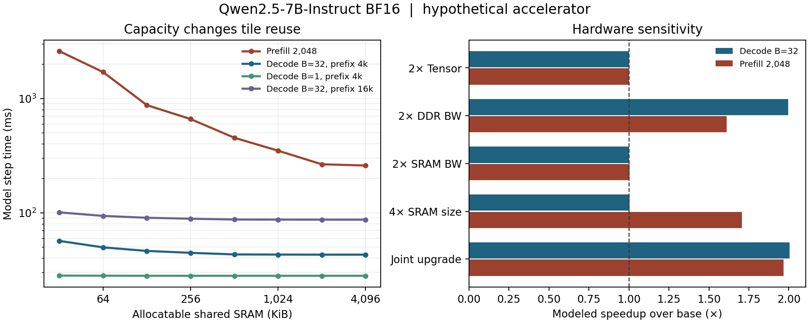

# Transformer 推理的 DDR、Tensor、Vector 与共享 SRAM 配比

**研究对象。** 选取项目已有 benchmark 对应的 Qwen2.5-7B-Instruct，建立可逐层复算的单设备 BF16 dense GQA 模型，再用 DeepInfer 的部署和专家分片说明多设备扩展。统一将片外工作存储器记作 DRAM。目标加速器可以用 DDR，公开 A100 测试使用 HBM，二者使用各自的有效带宽。速率用十进制 GB/s、TFLOP/s，容量用 KiB、MiB，FMA 计 2 FLOP。[Qwen 官方配置](https://huggingface.co/Qwen/Qwen2.5-7B-Instruct/raw/main/config.json) · [实测资料与源码索引](inference_resource_evidence.md)

**一个可验证的配比结果。** 假设有效 DDR 512 GB/s、Tensor 128 TFLOP/s、共享 SRAM 512 KiB，在本文的数据流下，32 路、每路已有 4,096 token 的一步 decode 需搬运 22.12 GB，耗时 43.20 ms。只把 SRAM 加到 2 MiB，步时降至 43.00 ms。对 2,048-token prefill，同一改动把搬运量从 231.85 GB 降到 125.68 GB，步时从 452.83 ms 降到 265.33 ms。两者差异可以定位到哪些矩阵或 KV 条带被重复读取。以下设计点是假设设备上的分析结果，A100 对照另列于第 7 节。

## 1. 把框架的一次调度变成算子形状

一次调度可同时处理若干请求。对请求 $i$，记 $p_i$ 为已经计算且可见的前缀长度，$q_i$ 为本轮新算的 token 数。满因果 attention 下，线性层的行数 $M$、每个 Q 头的有效配对数 $A$、需要投影到词表的行数 $J$ 是三个不同的量。

$$
M=\sum_i q_i,\qquad
A=\sum_i\left(q_i p_i+\frac{q_i(q_i+1)}2\right),\qquad 0\le J\le M .
$$

| 调度情形 | $M$ 与 $A$ | 对硬件的意义 |
|---|---|---|
| 首次 prefill，单请求长度 $P$ | $M=P,\ A=P(P+1)/2$ | 多行复用权重。标准生成只对末行算 logits，$J=1$ |
| 已缓存 $p$，继续 prefill $q$ 行 | $M=q,\ A=qp+q(q+1)/2$ | 新行仍访问历史 KV。中间块可取 $J=0$ |
| 常规 decode，$B$ 条请求 | $M=J=B,\ A=\sum_i(p_i+1)$ | 权重可在请求间复用。各请求有自己的历史 KV |
| 混合批次 | 分别累加各请求的 $q_i,A_i,J_i$ | 可以合并线性层。attention 不产生跨请求配对 |

vLLM V1 的 chunked prefill 能先安排等待的 decode，再用余下 token 预算分割 prefill。PagedAttention 把逻辑 token 块映射到物理 KV 块，允许符合条件的前缀共享。分页影响外存容量、地址连续性与有效带宽。不同 query 即使映射到同一个块，硬件能否共用一次读取仍取决于执行次序和片上驻留。[vLLM v0.10.1.1 调度说明](https://docs.vllm.ai/en/v0.10.1.1/configuration/optimization.html#chunked-prefill) · [PagedAttention 原论文](https://arxiv.org/abs/2309.06180)

一次前向从 token ID 查 embedding，随后依次经过下表中的层，最后做 RMSNorm、词表投影和 token 选择。记隐藏宽 $H$、FFN 中间宽 $I$、Q/KV 头数 $h,h_k$、头维 $d$、KV 单侧宽 $K=h_kd$、层数 $L$、词表大小 $V$，其中 $H=hd$。Qwen 的联合投影与行列切分可在框架源码中定位。[vLLM Qwen2 实现](https://github.com/vllm-project/vllm/blob/v0.10.1.1/vllm/model_executor/models/qwen2.py) · [Qwen2 的 RMSNorm、RoPE 与 MLP 实现](https://github.com/huggingface/transformers/blob/v4.46.0/src/transformers/models/qwen2/modeling_qwen2.py)

| 顺序 | Tensor 工作 | Vector / 搬运工作 |
|---|---|---|
| 1. Attention 输入 | QKV 联合投影 $[M,H][H,H+2K]$ | 前置 RMSNorm，QKV bias，Q/K 的 RoPE，写新 K/V |
| 2. Attention | 每个 Q 头执行 $QK^\top$ 与 $PV$ | 逐块缩放、因果遮罩、行最大值、exp、行和、重标定与归一化 |
| 3. Attention 输出 | $[M,H][H,H]$ | 加残差并保留结果作为 FFN 的残差输入 |
| 4. FFN | 联合 gate/up 投影 $[M,H][H,2I]$，down 投影 $[M,I][I,H]$ | 前置 RMSNorm，$\operatorname{SiLU}(gate)\times up$，加残差 |
| 5. 最终输出 | 选中的 $J$ 行做 $[J,H][H,V]$ | 最终 RMSNorm 与采样。可运行基线采用 greedy argmax |

### 有效计算与最少数据量

每层大矩阵的参数数为 $W_\ell=2H^2+2HK+3HI$。有效 Tensor FLOP 为

$$F_{\rm useful}=2LMW_\ell+4LH A+2JHV.$$

前两项分别计线性层和 attention。所有 GQA 查询头都要算点积，故 attention 计算量随 $h$ 变化。KV 存储由 $h_k$ 决定。矩形 tile 对因果对角线的额外运算见第 4 节。逐步流过的大矩阵权重字节数在理想一次读取下为 $D_W=b_w(LW_\ell+\mathbf{1}_{J>0}HV)$。输入 embedding 只读选中的行。完整模型的外存容量仍须包含整张 embedding 表。Qwen2.5-7B 的词表输入和输出权重独立。[GQA 原论文](https://arxiv.org/abs/2305.13245) · [模型参数](https://huggingface.co/Qwen/Qwen2.5-7B-Instruct/raw/main/config.json)

对本模型 $L=28,H=3584,I=18944,h=28,h_k=4,d=128,V=152064$，BF16 每元素 2 B。每轮若所有大矩阵只读一遍，含 LM head 共 **14,140,571,648 B**。每个存入 cache 的 token 全层需 $u=2Lb_{kv}K=$ **57,344 B，即 56 KiB**。32 个互不共享前缀的请求、各有 4,096 个历史 token 时，仅历史 KV 就有 7.516 GB。若页大小为 $P_b$ 个 token，无共享时分配量为 $uP_b\sum_i\lceil(p_i+q_i)/P_b\rceil$，另加页表等元数据。有共享时按唯一物理页计容量。

均长 decode、无持久片上权重、每组 GQA 的历史 KV 读一遍时，权重与历史 KV 读量相等的边界为

$$B p=\frac{D_W}{u}=246{,}592 .$$

$p=4096$ 时落在 $B=60$ 与 61 之间。固定 $B=32$ 时，对应 $p=7706$。这是区分两类外存流量的交点。即使 DDR 在交点两侧都限制吞吐，长上下文一侧做 KV 压缩或增加 GQA 头间复用，比改善已经单读的权重更能改变总字节数。若 KV 每组重读 $r$ 次，交点相应除以 $r$。

## 2. 四种资源怎样进入同一个时间公式

令 $g$ 为有前后依赖的一段内核，$t$ 为其 tile 和驻留策略。对它统计片外字节 $D_g$、共享 SRAM 端口字节 $U_g$、Tensor 运算 $F_g$，以及各类 Vector 元素操作 $N_{g,j}$。芯片参数为持续有效片外带宽 $B_D$、双向合计 SRAM 带宽 $B_S$、Tensor 吞吐 $P_T$ 和各向量通路的吞吐 $P_j$。共同读写端口上的所有字节先相加。基线假设 ADD、MUL、EXP、RED、INV 可独立服务，INV 为 reciprocal/rsqrt 的合并通路。若 reduction 也占用同一 ALU，应在该通路累加相应的服务周期。

$$
\begin{aligned}
C_{\rm tile}&=(C_{\rm shared}-C_{\rm reserve})/n_{\rm resident},\\
t_g^*&=\arg\min_{t:\ S_g(t)\le C_{\rm tile}}\ 
\max\left\{\frac{D_g(t)}{B_D},\frac{U_g(t)}{B_S},
             \frac{F_g(t)}{P_T},\max_j\frac{N_{g,j}(t)}{P_j}\right\},\\
T_{\rm step}&=\sum_g n_g\, T_g(t_g^*) .
\end{aligned}
$$

$S_g$ 是一个 tile 的峰值同时存活字节，$n_g$ 是执行次数。跨层顺序、kernel 间屏障在阶段求和时体现。每段内部取 max 是乐观重叠估算，未显式模拟启动、流水首尾、DMA 抢占、bank 冲突或依赖停顿。把全模型每种资源的服务时间先相加、最后只取一次 max，可以得到同一工作账目的更松下界。若有实际跨 kernel 融合、旁路或流水重叠，应重新划分阶段及其界面流量。这个写法沿用 Roofline 的资源服务时间思想，并增加了容量约束和独立执行单元。[Roofline 原文](https://escholarship.org/uc/item/5tz795vq)

给定吞吐目标 $x$，每步有 $z$ 个所考核的 token，时间预算是 $\tau=z/x$。在固定映射下，以下是**同时需要满足的平均速率下限**。逐阶段重新求和才能判断目标是否达到。

$$
B_{D,\min}=\frac{\sum_g n_g D_g}{\tau},\quad
P_{T,\min}=\frac{\sum_g n_g F_g}{\tau},\quad
P_{j,\min}=\frac{\sum_g n_g N_{g,j}}{\tau},\quad
B_{S,\min}=\frac{\sum_g n_g U_g}{\tau}.
$$

例如一个 Tensor 段要在指定 $P_T$ 下满速执行，需要 $B_D\ge P_TD_g/F_g$、$B_S\ge P_TU_g/F_g$、$P_j\ge P_T N_{g,j}/F_g$。理想权重单读且其余访存较小时，GEMM 的权重算术强度为 $2M/b_w$。示例硬件的 $P_T/B_D=250$ FLOP/B，在 BF16 下需要约 250 行权重复用才可能喂满 Tensor。实际还要读激活、写输出、重装 tile。满带宽的长上下文 decode attention 只计一次 KV 扫描时，其强度约为 $2(h/h_k)/b_{kv}=7$ FLOP/B，随 $B$ 同比扩大的工作和 KV 字节会相互抵消。

服务端 TTFT 含排队、各 prefill chunk、最终 logits 和交付首 token；同一请求连续两个输出之间的时间含中途等待调度。固定全 decode 批、请求每步均前进一步时，设备步时可作为单请求 ITL 的计算部分，整批输出速率取 $B/T_{\rm step}$。混合批次按实际产出 token 计输出吞吐，prompt token 只计输入工作量。

## 3. SRAM 如何改变矩阵投影的 DDR 流量

对 $[M,K_0][K_0,N]$ 的 GEMM，选输出块 $m\times n$、内积板宽 $k$。基线将 FP32 累加块留在共享 SRAM，输入和权重做双缓冲。令 $n_m=\lceil M/m\rceil,\ n_n=\lceil N/n\rceil,\ n_k=\lceil K_0/k\rceil$，并记 $X=b_a M K_0,\ W=b_w K_0N,\ Y=b_aMN$。表中的容量包括尾块按最大 tile 分配的缓冲。

| 数据流 | SRAM 容量 $S_g$ | DDR 字节 $D_g$ |
|---|---|---|
| 输出块内流式装入 X、W 板 | $4mn+2k(b_a m+b_w n)$ | $n_n X+n_m W+Y$ |
| 保留完整 $K_0\times n$ 权重条带，遍历请求行 | $4mn+2kb_a m+2K_0b_w n$ | $n_n X+W+Y$ |
| 保留完整 $m\times K_0$ 激活条带，遍历输出列 | $4mn+2K_0b_a m+2kb_w n$ | $X+n_m W+Y$ |

三种策略进入引擎的数据量仍为 $n_nX+n_mW+Y$。每个非末内积板的累加块写回 SRAM、下轮读出，额外 $8MN(n_k-1)$ B。因此

$$U_g=D_g+(n_nX+n_mW+Y)+8MN(n_k-1),\qquad F_g=2MK_0N.$$

若阵列能在本地累加器中跨所有 $K_0$ 保留结果，应删去对应的部分和读写，并按阵列局部容量约束 $m,n$。这是能大幅改变 SRAM **带宽**需求的硬件接口。基线候选 $m,n$ 使用不超过 4,096 的二次幂及实际端点，默认 $k=64$ 可替换。所选结果是该候选集中的最低模型时间。

**实际代入一次。** 在 2,048-token prefill 的 gate/up 上，$K_0=3584,N=37888$。512 KiB 选择 $m=n=256$，工作集 384 KiB，权重读 8 遍，每层 2.173 GB；2 MiB 选择 $m=n=512$，工作集 1,280 KiB，权重读 4 遍，每层 1.086 GB。仅这一个投影的权重就节省约 30.42 GB/28 层。其余收益来自 down、其他投影和激活/KV 条带。

## 4. Attention 的因果分块、在线 softmax 与 Vector 配比

取 query-major，$r$ 为 query tile 行数，$c$ 为 KV tile 列数，$g$ 为同时复用同一 KV 头的 Q 头数，$G=h/h_k$。保留 BF16 Q、FP32 未归一化输出 $O$、每行 FP32 的最大值和分母、FP32 score scratch，以及双缓冲 K 与 V。概率原位覆盖 score，K/V 头按组推进。片上容量为

$$S_{\rm att}=gr[(b_a+4)d+8+4c]+4c d b_{kv}.$$

每个请求按 $r$ 行切 query。对每个块 $b$，设 $r_b$ 为实际行数，$e_b=p_i+\text{该块最后一行的序号}$（序号从 1 起）。块只取可见 KV 的并集 $1\ldots e_b$。块内上三角被 mask，计算账目计入矩形槽位，最右端和尾行按有效尺寸裁剪。令

$$
R=hM,\quad Z=h\sum_b r_b e_b,\quad
J_b^{\rm visits}=h\sum_b r_b\lceil e_b/c\rceil,\quad U=J_b^{\rm visits}-R .
$$

$R$ 是 Q 头行数，$Z$ 是执行 score 槽数，$J_b^{\rm visits}$ 是跨所有 KV tiles 的行访问次数，$U$ 是首块之后的重标定次数。理想有效 score 为 $h A$。将 K/V 先追加到片外 cache，再由 attention 读取，因此下式包含本轮新 KV 的回读；追加只在上一阶段记一次。

$$
D_{\rm KV,read}=2b_{kv}d h_k\lceil G/g\rceil\sum_b e_b,\quad
D_{\rm att}=D_{\rm KV,read}+2b_a dR,\quad F_{\rm att,exec}=4dZ .
$$

query tile 变小时，同一前缀会被多个块反复读取。$g$ 变小时，同一 KV 头需供更多组重新读取。对 $q_i=1$ 且 $g=G$ 的 decode，两种重读均消失。若中间 score 和概率跨 Tensor/Vector 需经共享 SRAM，则每槽的 Tensor→Vector FP32 和 Vector→Tensor BF16 交接共计 $8+2b_a$ B（各有一次写和读）。基线还计了 DMA、Q 的多块访问、中间 $O,m,\ell$ 的落地与重取。选择 PV 输出到累加器、末块归一化后直接写最终输出的路径，

$$ U_{\rm att}=D_{\rm att}+D_{\rm KV,read}+b_a d(J_b^{\rm visits}+R)+(8+2b_a)Z+2(4d+8)U .$$

每块求新最大值 $m'$，在线更新 $\alpha=\exp(m-m')$、$\ell'=\alpha\ell+\sum_j e^{s_j-m'}$、$O'=\alpha O+\sum_j e^{s_j-m'}V_j$，最后输出 $O/\ell$。这使 score scratch 的大小为 tile 面积；显式物化整行/整矩阵的策略还要为中间 score 和概率计片外写读。以下为基线的**元素服务次数**。内积归入 Tensor，水平比较与水平加法归入 RED，mask、索引和转换作为当前模型的控制/指令开销省略。[FlashAttention 算法及 I/O 分析](https://arxiv.org/abs/2205.14135) · [FlashAttention-2 分工与在线更新](https://arxiv.org/abs/2307.08691)

| 通路 | 单层 attention 工作量 | 对应操作 |
|---|---:|---|
| EXP | $Z+U$ | 每槽 exp、旧状态重标定 exp |
| ADD/SUB | $Z+(d+2)U$ | 减最大值、减旧/新最大值、合并分母与输出 |
| MUL | $Z+(d+1)U+dR$ | score 缩放、旧状态缩放、输出乘倒数 |
| RED | $2(Z-J_b^{\rm visits})+U$ | 块内最大值与和，新旧最大值比较 |
| INV | $R$ | 最终倒数 |

在 $U/Z$ 很小、只考察注意力内核时，维持 Tensor 满速所需的 EXP 约为 $P_T/(4d)$。$d=128$、$P_T=128$ TFLOP/s 对应 **250 Gexp/s**，RED 约需 **500 G 二元归约操作/s**。小 $c$ 时需加回重标定，DDR 主导的 decode 则可能只使用此处满速需求的一小部分。SwiGLU 每个 FFN 元素还包含一次 exp、一次 reciprocal、一次加和两次乘。若同一 SFU 实现 exp 和 reciprocal，要合并两类占用。项目中列出的 ALU/MUL/EXP/LD/ST 需通过实际通路和端口对照映射。[本项目 Vector 架构快照](../arch.r0.md)

其他阶段按 kernel 边界在片外物化。RMSNorm 读、写各 $M H$ 个激活并读一条缩放向量，行缓冲支持归约后二次读入；RoPE 共用每 token 的 $d$ 个 sin/cos 表元素并读一次 bias 条带；SwiGLU 读 gate/up 共 $2MI$，写 $MI$；每次残差加读两路、写一路。算术、norm 与 bias 的 SRAM 流量单列在脚本中。若相邻 kernel 融合，边界张量大小 $Y$ 的一次片外写读可省约 $2Y$ B，需同时重算融合后的峰值存活量与 SRAM 交接。

## 5. 假设设备的设计空间

取有效 $B_D=512$ GB/s，$P_T=128$ TFLOP/s，$B_S=8$ TB/s，$C_{\rm shared}=512$ KiB；ADD/MUL 各 2 T 元素操作/s，EXP、RED、INV 分别 0.25、1、0.125 T 元素操作/s。单 SRAM 分区、无固定预留，候选根据容量、带宽和向量速率共同选择。权重与 KV 跨步保存在片外，芯片内无跨 kernel 的隐式 L2 命中。一个端口字节代表一次真实读或写，默认有足够的引擎内广播与局部寄存器；Tensor 和 Vector 之间的 score/概率通过共享 SRAM。例子忽略 host、网络和服务队列。

| 一次前向 | 片外 GB | SRAM 端口 GB | 执行 Tensor TFLOP | 模型步时 ms | 速率与口径 |
|---|---:|---:|---:|---:|---|
| Decode $B=1,p=4096$ | 14.39 | 29.71 | 0.0158 | 28.10 | 35.6 输出 tok/s |
| Decode $B=32,p=4096$ | 22.12 | 76.49 | 0.5051 | 43.20 | 740.7 输出 tok/s |
| Decode $B=64,p=4096$ | 31.55 | 122.49 | 1.0102 | 61.63 | 1,038.4 输出 tok/s |
| Decode $B=32,p=16384$ | 44.67 | 126.85 | 0.6630 | 87.24 | 366.8 输出 tok/s |
| Prefill $B=1,q=2048,p=0$ | 231.85 | 2,153.39 | 27.6757 | 452.83 | 4,522.7 输入 tok/s，产出首 token |
| 32 路 decode $p=4096$ 加 1 路中间 chunk $q=256,p=2048$ | 39.43 | 341.82 | 4.0730 | 77.02 | 3,739.3 调度 tok/s，415.5 输出 tok/s |

同一混合批若分两轮顺序执行，设备时间是 $43.20+57.24=100.44$ ms。合并投影节省约 23.42 ms，但 decode 请求本轮要等 77.02 ms，相对单独执行增加 33.82 ms。另一个切分例子把单路 2,048-token prompt 切成四个 512-token chunk，前三块取 $J=0$，末块取 $J=1$。四块步时分别为 111.25、112.27、113.08、116.01 ms，总计 452.60 ms。这一配置下总服务时间近似持平，但调度器有了三个可插入 decode 的边界。

| 硬件变化，每行从基线出发 | Decode 32 路 × 4K，ms | Prefill 2K，ms | Prefill 时间的主要约束 |
|---|---:|---:|---|
| 基线 | 43.20 | 452.83 | 片外搬运 |
| DDR 加倍至 1,024 GB/s | 21.64 | 281.16 | SRAM 端口所限阶段合计 259.6 ms |
| Tensor 加倍至 256 TFLOP/s | 43.20 | 452.83 | 片外搬运 |
| SRAM 端口加倍至 16 TB/s | 43.20 | 450.98 | 片外搬运 |
| SRAM 容量从 512 KiB 到 2 MiB | 43.00 | 265.33 | SRAM 端口所限阶段合计 233.5 ms |
| EXP 降至 15.625 Gexp/s | 44.09 | 606.58 | 各阶段中 EXP 限制时间达 175.3 ms |
| RED 降至 62.5 G 二元操作/s | 43.31 | 498.50 | RED 限制时间达 57.7 ms |
| 同时给 1,024 GB/s DDR、2 MiB SRAM、16 TB/s SRAM 端口 | 21.54 | 230.36 | Tensor 所限阶段合计 208.8 ms |

图中左侧纵轴为对数步时，右侧是相对基线的加速比，联合升级对应上表末行。循环次序和片上条带驻留能让某个实现的 prefill 先遇到 DDR 瓶颈，改善片内外供数后才转到 Tensor。每个阶段的 tile、工作量和瓶颈时间保存在数值结果中。[可复算的逐阶段结果](artifacts/inference_resources/study.json)

**从目标反推规格。** 固定 $B=32,p=4096$、目标 1,000 输出 tok/s，给每步 32 ms。代入基线选定数据流，最低平均服务率为 DDR **691.24 GB/s**、SRAM 端口 **2.390 TB/s**、Tensor **15.79 TFLOP/s**；ADD/MUL/EXP/RED/INV 分别为 **5.82 / 6.83 / 3.76 / 6.77 / 0.53 G 元素操作/s**。保持其余资源在基线值、只改 DDR 为 700 GB/s，逐阶段重算得到 31.60 ms、1,012.7 输出 tok/s。不能将所有通路同时降至这些平均值仍承诺达标。若要求 32 路每路 ITL 小于 20 ms，相应目标是至少 1,600 输出 tok/s，同一流量就要求 DDR 至少约 1.106 TB/s，还需核对所有阶段和调度空隙。

## 6. 从单设备推广到 vLLM 分片与 DeepInfer

| 切分 | 每设备应计什么 | 产生的附加项 |
|---|---|---|
| 请求 DP | 每副本复制模型，按本地 $M,A$、活跃请求和前缀重新计 | 尾延迟由最慢副本和路由决定，短请求数量与总 KV 长度都须平衡 |
| Tensor parallel | QKV 和 gate/up 常按列分，O 和 down 常按行分；每 rank 执行其矩阵片 | 常见实现每层两次行并行结果归并；对 $t$ 路 ring all-reduce，一次每 rank 单方向发送约 $2(t-1)MHb_a/t$ B，并有启动延迟。分离计算、通信与可重叠部分 |
| Context / split-KV | 按序列范围分配 KV，计算分片本地有效配对，分别产出部分 $O,\ell,m$ | 在线 softmax 归并，局部输出与统计量的读写、跨核或跨卡归约。提高小 batch 并行度也会增加归并成本 |
| Pipeline parallel | 按本地层数计工作和存储 | 单请求串行经历所有 stage。稳态 microbatch 间隔受最慢 stage 和激活传输限制 |
| P/D 分离 | 两个池分别按输入、输出负载选资源 | 若无远端命中/复制，单请求 $P$ 个 dense GQA token 的 KV 交接约 $uP$ B，链路服务时间至少为该量除以有效链路带宽 |

例如 Qwen 只有 4 个 KV 头，vLLM 按头切分时要检查可整除性，超过 KV 头数时可在 rank 间复制。其 28 个 Q 头也须兼容 TP 度。在可行的纯头切分里，TP=2 时每卡 14 个 Q 头与 2 个 KV 头；TP=4 时每卡 7 个 Q 头与 1 个 KV 头。任意指定一个 TP 度后把所有时间和 KV 字节机械地除以它会错计。[vLLM Qwen2 分片代码](https://github.com/vllm-project/vllm/blob/v0.10.1.1/vllm/model_executor/models/qwen2.py) · [Flash-Decoding 的 split-KV 归并](https://pytorch.org/blog/flash-decoding/)

DeepInfer 的 V4.1 Flash 部署用 attention DP、MoE EP，拆开视觉编码、prefill 与 decode 池，公开 Q&A 给出 prefill 2–8 路、decode 64–128 路 EP/DP。该生产配置未启用 TP 和 CP。开源框架支持的并行方式比这一组生产取值更广。其 prefill 调度用前缀长度和新增长度估算 chunk 耗时，decode 均衡同时看请求数和 KV 总长度。这两种负载都能由第 1 节的输入表示。[DeepInfer 部署说明](https://github.com/deepseek-ai/DeepInfer/blob/a679bb86ce36e883a98a97733492b686e5b9a08e/doc/inference_deployment_qa.md)

**专家数值例子。** V4.1 Flash 文本配置含 384 个 routed expert，每 token 选 6 个，另有 1 个共享专家；$H=5120,I_e=2304$，routed expert 格式为 FP4。每个 SwiGLU 专家的三块矩阵共 $W_e=3HI_e=35,389,440$ 个权重。对一个 EP 组的一层，记 $m_e$ 为本轮派给专家 $e$ 的 token 数，则

$$F_{\rm routed}=2W_e\sum_e m_e,\qquad D_{W,\rm routed}=b_e W_e\sum_e\mathbf1_{m_e>0}.$$

若每个 token 均匀无放回选 6 个且 token 间独立，$M$ 个 token 触及的不同专家期望为 $384[1-(1-6/384)^M]$。$M=32$ 对应 **152.01** 个专家、**2.690 GB** 原始 FP4 权重、**13.590 GFLOP**；$M=1$ 对应 6 个专家、0.106 GB。此例假设每个活跃专家权重只装一次，未加打包补齐、scale、共享专家及路由开销。实际需按每 rank 的 $m_e$ 和副本位置计时，并取最慢 rank。若共有 $k_r M$ 次专家选择、跨 rank 比例为 $f_{\rm remote}$，无目的 rank 合并时 dispatch 加 combine 的有效载荷量级为 $2 b_a H k_r M f_{\rm remote}$ B，再加入元数据和拓扑约束。[V4.1 Flash 配置](https://huggingface.co/deepseek-ai/DeepSeek-V4.1-Flash-1017/raw/main/config.json) · [DeepInfer MoE 实现](https://github.com/deepseek-ai/DeepInfer/blob/a679bb86ce36e883a98a97733492b686e5b9a08e/deepinfer/model_executor/models/v4_modules/moe.py)

V4.1 的 KV 流量需分开计滑窗、本轮访问的压缩块、索引与状态，按实际 source layer、缓存布局、量化比例和命中来求和。模型配置给出的滑窗为 128、index top-k 为 512，二者对应不同阶段。推测解码要把 draft 工作、验证工作和回退算入分子，以实际提交输出数为分母。公开材料不足以用本文的 Qwen 脚本重建生产集群吞吐，本文对 DeepInfer 给出可代入 trace 的分片表达式及单层专家算例。[DeepInfer 公开范围](https://github.com/deepseek-ai/DeepInfer/tree/a679bb86ce36e883a98a97733492b686e5b9a08e) · [KV 存储设计](https://github.com/deepseek-ai/DeepInfer/blob/a679bb86ce36e883a98a97733492b686e5b9a08e/doc/inference_deployment_qa.md#kv-cache-storage)

## 7. 用公开测量检验量级与误差

**整模型。** Qwen 团队在单张 A100 80 GB、vLLM 0.6.3、BF16、batch 1 上生成 2,048 个 token。指标是输出 token 数除以整次生成时间。为对齐这个计时范围，另建简化的 A100 对照式。令 $P$ 为输入长度、$n=2047$ 为首 token 之后的 decode 步数。从首个测点只拟合一个逻辑字节服务率 $\beta=1.1967$ TB/s，prefill 取 A100 dense BF16 公开峰值 $P_{100}=312$ TFLOP/s，无额外拟合。

$$
\begin{aligned}
T_{\rm first}&=\max[(D_W+uP)/\beta,\ F_{\rm useful}(P,J=1)/P_{100}],\\
T_{\rm rest}&=[nD_W+u(n(P+1)+n(n-1)/2)]/\beta,\\
x_{\rm out}&=2048/(T_{\rm first}+T_{\rm rest}).
\end{aligned}
$$

该对照中 prefill 字节项保留权重及 KV 写入，decode 计历史 KV 读和一次新 KV 写；初始化、采样及 kernel 开销摊进首点有效率。它使用理想权重单读和 KV 交接，单独用于验算随长度的变化。[Qwen 原始测点](https://qwen.readthedocs.io/en/v2.5/benchmark/speed_benchmark.html) · [Qwen 计时实现](https://github.com/QwenLM/Qwen3/blob/8205ba2a17690375467df31481412d65a1751271/examples/speed-benchmark/speed_benchmark_vllm.py) · [NVIDIA A100 规格](https://www.nvidia.com/en-us/data-center/a100/)

| 输入 token | 实测输出 tok/s | 模型输出 tok/s | 对实测的相对误差 |
|---:|---:|---:|---:|
| 1 | 84.28 | 84.28 | 标定点 |
| 6,144 | 80.70 | 81.36 | +0.82% |
| 14,336 | 77.69 | 77.50 | −0.25% |
| 30,720 | 70.33 | 70.15 | −0.25% |

同一模型、batch、输出长度的这三个留出点表明，权重常数项加增长的 KV 项能解释这组整段速度趋势。一个输出吞吐指标无法分别识别 DDR 物理效率、Tensor 利用率、Vector 带宽和 SRAM 容量；不同资源误差也可能抵消。公开表未区分 A100 80 GB 的 PCIe/SXM 版，其 HBM 峰值分别为 1.935/2.039 TB/s。这组拟合不校准第 5 节假设芯片的片上数据流。

**Attention 内核。** Flash-Decoding 作者给出 A100 FP16、单层、单 token、16 Q 头、2 KV 头、$d=128$ 的结果。$B=1$、上下文 65,536 时，逻辑 KV 共 67,108,864 B，实测 64.4 µs，对应 1.042 TB/s。只用这一常带宽预测 131,072 时得到 128.8 µs，实测 106.6 µs，延迟偏高 **20.8%**。相同 65,536 形状的旧版 FlashAttention v2.0.9 实测 2,300.6 µs。split-KV 增加可并行任务和归并开销，虽有同样的逻辑 KV 量，实际利用率差异很大。[Flash-Decoding 原始表](https://pytorch.org/blog/flash-decoding/)

**Vector 内核。** Triton 官方 FP32、$4096\times4096$ 行 softmax 基准，融合实现和朴素分解分别为 1,404.67、338.35 GB/s，统一按最少的输入加输出字节计。融合实现折合 175.58 G 输出元素/s。这给出了融合与减少访存的实测效果。孤立的 EXP 发射吞吐还需另测。公开资料附录也收录了有明确形状的 prefill 类非因果 attention 前向，与 decode 及训练口径分别列示。[Triton softmax 基准](https://triton-lang.org/main/getting-started/tutorials/02-fused-softmax.html) · [公开实测附录](inference_resource_evidence.md)

## 8. 复算与目标芯片标定

在项目根目录的 WSL shell 执行。主模型只依赖 Python 标准库，绘图选项使用 matplotlib。

~~~bash
python3 -B scripts/inference_resources.py --group 32,1,4096 --ddr-gbs 700
python3 -B scripts/inference_resources.py --group 1,2048,0 --sram-kib 2048
python3 -B scripts/inference_resources.py --group 32,1,4096 --group 1,256,2048 --logit-rows 32
python3 -B scripts/inference_resources.py --group 1,512,1536 --sram-kib 2048 --resident-tiles 4 --panel-k 128
python3 -B scripts/inference_study.py --plot
~~~

每个 group 依次是请求数、新算 token 数、此前缓存长度。默认各请求各产生一行 logits，未结束的 prefill chunk 应显式指定所需 logits 行数。运行输出含逐阶段 FLOP、各向量操作量、DDR/SRAM 字节、所选 tile、片上工作集和瓶颈。基线只内置 dense Qwen2 风格完整因果 attention；公开 A100 对照、容量扫描、硬件敏感度由研究脚本重建。[模型实现](scripts/inference_resources.py) · [实验脚本](scripts/inference_study.py) · [完整数值结果](artifacts/inference_resources/study.json)

要把资源配比用于目标芯片，最有辨识度的测点是独立改变一个资源压力。先用相同精度的 GEMM 做 $M=1,32,256,2048$ 的扫描，记录 Tensor 活跃周期和 DDR 实读；固定 $B,p$ 扫 $r,c,g$，记录每块 KV、score、部分和经过 DDR/SRAM 的字节；分别测独立 EXP、归约、相依 softmax 循环的有效服务率。再用未参与标定的混合批次比较逐 kernel 时间、整步时间与 TTFT/ITL。若 SRAM 容量变化时 DDR 字节不变而时间改变，应检查端口、并行度和占用率；若实际字节随容量的台阶与模型不同，应回溯驻留/重装和融合边界。这样可以从误差定位到具体的数据流或执行通路。[本项目 Qwen benchmark 分层方案](../qwen.benchmark.overview.md)
