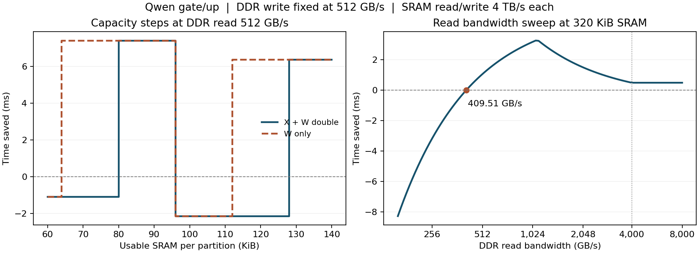

# 固定 SRAM 下的单缓冲与双缓冲

以 Qwen2.5-7B 的一层 gate/up 投影作控制实验，形状为 $[2048,3584][3584,37888]$。同一行比较使用相同的容量、端口和引擎，分别为输入 $X$ 和权重 $W$ 选择 1 或 2 个槽位。下文时间单位为 ms，均为模型值。逐块模型对应原报告的输出块驻留、输入板流式加载策略，显式计入填充、排空、输出回写和可重叠的输入搬运。原报告中融合、条带驻留和全步所有算子的时间另有适用范围。[原模型](inference_resource_model.md) · [对照脚本](scripts/pingpong_tradeoff.py)

## 1. 把容量代价落实到发生重读的维度

本节的矩阵乘是 $Y=XW$。$X[M,K]$ 是激活，$M$ 为 token 行数，$K$ 为每行输入特征数。$W[K,N]$ 是权重，$N$ 为输出特征数。一个输出块（tile）覆盖 $Y$ 的 $m$ 行、$n$ 列。为算完其中一个元素要沿完整的 $K$ 维做点积，每次只取 $k$ 个位置；这次取出的 $m\times k$ 输入和 $k\times n$ 权重称为一对内积板（panel）。同一输出块会接收多对板，前一对的部分和要保留给后一对。

令 $m,n,k$ 分别为输出行块、输出列块、内积块宽，$s_X,s_W\in\{1,2\}$。BF16 输入、权重和输出，FP32 部分和驻留共享 SRAM。每个执行分区可用容量为 $C$，已扣除常驻元数据、其他并发任务的份额。该数据流满足

$$S=4mn+2k(s_Xm+s_Wn)\le C.$$

对 $[M,K][K,N]$，输入板固定循环次序、无跨输出块缓存命中时，DDR 读写总量为

$$D=2MK\lceil N/n\rceil+2KN\lceil M/m\rceil+2MN.$$

| 项 | 计的是什么 | 为什么这样乘 |
|---|---|---|
| $4mn$ | 常驻 SRAM 的输出部分和 | 每个输出位置存 1 个 4 B 的 FP32 累加值，共 $mn$ 个。 |
| $2kms_X$、$2kns_W$ | 所有激活槽、所有权重槽的 SRAM 占用 | 两种板分别有 $mk$、$kn$ 个 BF16 元素，每个 2 B。乘以各自的槽数；槽数为 2 时，当前板和下一板可同时存在。三项相加为峰值占用 $S$，须小于或等于可用字节 $C$。 |
| $2MK\lceil N/n\rceil$ | 从 DDR 读入的激活字节 | 全部 $X$ 读一次是 $2MK$ B。输出每换一组 $n$ 列，按本节的循环顺序重新用到全部 $X$；不足一组的尾列也要访问，故遍历次数向上取整。 |
| $2KN\lceil M/m\rceil$ | 从 DDR 读入的权重字节 | 全部 $W$ 为 $2KN$ B，每处理一组新的 $m$ 行，就再遍历一次权重。 |
| $2MN$ | 向 DDR 写出的最终结果 | $MN$ 个 BF16 元素各写一次。部分和在 SRAM 内更新，未计入这笔片外流量。三项之和 $D$ 是一次完整投影累计的读加写。 |

第一个输入沿 $n$ 列复用，一个权重沿 $m$ 行复用。缩小 $m$ 会在 $\lceil M/m\rceil$ 增大时增加权重读取，缩小 $n$ 类似地增加输入读取。在边界区间内 tile 变小也可能保持相同的遍历次数。缩小 $k$ 可以保持两个外层复用维度，但部分和经 SRAM 取回、写回的额外流量是 $8MN(\lceil K/k\rceil-1)$。对相同 $m,n,k$，分配额外槽位本身不改变 DDR 流量。

例如 $m=n=256,k=64$，256 KiB 为输出累加块，X 与 W 每板各 32 KiB。一个槽位、单操作数双槽、两个操作数双槽分别占 320、352、384 KiB。320 KiB 若改用 $k=32$，双槽也能保留 $256\times256$ 的输出块。其 DDR 仍为 4.500 GB，但 SRAM 端口流量从 43.143 增至 77.905 GB，内积板从 56 个增至 112 个。在原模型的离散候选集里允许 $k=32,64,128$ 时，这个 320 KiB 双槽方案耗时 10.120 ms，单槽最优为 13.659 ms。

上述 $8MN(\lceil K/k\rceil-1)$ 中，$\lceil K/k\rceil$ 是完成一次点积需要的板数，减 1 得到相邻板之间交接的次数。每次交接对每个输出元素先写 4 B 部分和、再读 4 B，共 8 B。对所有 $MN$ 个输出累加即可。原例中 $3584/64=56$，换成 $k=32$ 后变成 112 板。按两个字节域复核，DDR 仍是 4.500488 GB；SRAM 总读写是 $2D+8MN(\lceil K/k\rceil-1)$：$2D$ 对应输入的“DMA 写入、引擎读取”和输出的“引擎写入、DMA 读出”，其余才是中间交接。由此得到 43.143 与 77.905 GB。两级流量不能相加后除以同一带宽。

## 2. 从硬件参数直接计算净收益

**外部输入。** 算子形状 $[M,K][K,N]$、各张量的元素字节宽度 $b_X,b_W,b_Y$；DDR 带宽和启动延迟 $B_D,\ell_D$；DMA 带宽和启动延迟 $B_A,\ell_A$；共享 SRAM 的可用容量、总读写带宽和启动延迟 $C,B_S,\ell_S$；Tensor 吞吐和启动延迟 $P_T,\ell_T$；Vector 各操作通路的元素吞吐和启动延迟 $P_{V,u},\ell_{V,u}$。统一使用 B、B/s、FLOP/s、元素操作/s 和秒。若规格给位宽，先除以 8。部分和固定为 FP32，即每元素 4 B。下文的板宽、计数、字节量和时间均由这些输入推导；槽位数取待比较方案的固定值。

**执行约定。** 一个输出块沿 $K$ 切板；板内 Tensor 运算与持续供数流式重叠，连续 SRAM 读写合并成一段引擎服务。一个待搬入的操作数组按一次逻辑 DMA 计，分离的预取组和补载组分别启动。输入在当前板消费完成时释放，输出块之间串行写回。DDR、DMA 与 SRAM 在首字到达后可流式传输，读、写先取相同硬件参数。下式给出这一调度的理想资源时间；真实控制器的访存布局、bank 仲裁或多条 DMA 描述符会改变结果。延迟按一次逻辑服务的启动截距计，带宽按启动后的持续速率计，以免重复计算首字时间。

### 2.1 单块的尺寸、字节和计算时间

选输出 tile $(m,n)$、内积板宽 $k$。输出块从下标 $(a,b)$ 开始，下标分别以 $m,n$ 为步长遍历；其真实尺寸 $r=\min(m,M-a),\ c=\min(n,N-b)$。板数 $h=\lceil K/k\rceil$，第 $j$ 板宽 $v_j=\min(k,K-(j-1)k)$，$j=1,\dots,h$。输入和最终输出的字节数为

$$x_j=b_Xrv_j,\qquad w_j=b_Wv_jc,\qquad z_j=x_j+w_j,\qquad y=b_Yrc.$$

下标 $a,b$ 是输出块左上角的行、列坐标，从 0 起；$M-a,N-b$ 是还剩多少行、列，因此用 $\min$ 截断边界。板号 $j$ 从 1 起，前面已消费 $(j-1)k$ 个内积位置。比如 $K=65,k=64$ 时 $h=2$、$v_1=64,v_2=1$。$x_j,w_j$ 分别是两个输入切片的**实际元素数乘各自的字节宽度**；$z_j$ 是本板逻辑输入搬入量；$y$ 是整个输出块算完后的写出量，沿 $K$ 只写一次。

对槽数策略 $s=(s_X,s_W)$，单槽、仅 X 双槽、仅 W 双槽、两者双槽依次为 $(1,1),(2,1),(1,2),(2,2)$。可行条件和全矩阵的 DDR 流量分别是

$$
S_s=mn\max(4,b_Y)+k(s_X b_Xm+s_W b_Wn)\le C,\qquad
D=b_XMK\lceil N/n\rceil+b_WKN\lceil M/m\rceil+b_YMN.
$$

输出缓冲与累加块复用。更小的 $m$ 或 $n$ 可能提高上述向上取整的遍历次数。只改 $k$ 时 DDR 字节不变，但内积板数和部分和读写会变。当前板需要 $2rcv_j$ FLOP；其引擎侧 SRAM 字节包括输入、前板部分和的读、本板部分和或最终输出的写：

$$U_j=z_j+4rc\big(\mathbf1_{j>1}+\mathbf1_{j<h}\big)+y\,\mathbf1_{j=h}.$$

一般位宽下，$S_s$ 的三项沿用第 1 节的输出、X、W 三块空间。输出与其部分和原位复用，故每个位置按 $\max(4,b_Y)$ B 分配。$D$ 的三个物理动作仍是重读 X、重读 W、写出 Y，只需分别把 2 B 换成 $b_X,b_W,b_Y$。$U_j$ 专计引擎侧 SRAM 字节：$z_j$ 为读取 X/W；$\mathbf1$ 在条件成立时取 1，否则取 0。$j>1$ 要读前板部分和，$j<h$ 要写部分和给后板，每次都是 $rc$ 个 FP32；$j=h$ 则写最终 $y$ 字节。只有一板时两项部分和交接都为零。

定义一次搬运和一次独立计算的服务时间

$$
L(z)=\begin{cases}
0,&z=0,\\
\ell_D+\ell_A+\ell_S+z/\min(B_D,B_A,B_S),&z>0,
\end{cases}
\qquad E_j=\max\!\left(\ell_T+\frac{2rcv_j}{P_T},\ \ell_S+\frac{U_j}{B_S}\right).
$$

$L(y)$ 同样用于最终输出回写。DDR 与 DMA 是同一传输路径上的环节，启动延迟相加，流式传输速率取路径最小值。纯 gate/up 投影的 Vector 操作数为零，因此不产生 Vector 启动时间。

两式都给出时间。$L(0)=0$ 表示空传输不发 DMA；非空时，字节除以 B/s 是持续传输时间，加上三个启动截距。$E_j$ 的第一项将 $rc$ 个点积片段、每段 $v_j$ 次乘加、每次 2 FLOP 相乘，再除以 Tensor 持续吞吐，并加本板计算启动延迟。第二项是 SRAM 处理 $U_j$ 字节所需的持续时间加启动延迟。两条路径在本板内部可流式重叠，必须等较慢者完成，故取最大值。

### 2.2 首板、稳态、尾板与净收益

对于 $j<h$，下一板能在本板计算时预取的字节，以及必须等单槽释放后补载的字节为

$$p_{j+1}=(s_X-1)x_{j+1}+(s_W-1)w_{j+1},\qquad u_{j+1}=z_{j+1}-p_{j+1}.$$

本板计算与预取的并发窗口用下式估计。共享端口既要服务引擎的 $U_j$ 字节，也要服务 DMA 的 $p$ 字节：

$$J_j(p)=\max\!\left(E_j,\ L(p),\ \ell_S+\frac{U_j+p}{B_S}\right).$$

$(s_X-1)$ 是激活的预取开关：单槽时等于 0，双槽时等于 1；$(s_W-1)$ 对权重同理。故 $p_{j+1}$ 是下一板提前搬的那部分，$u_{j+1}$ 是释放单槽后才能补的剩余字节。$J_j$ 中三个时间分别约束当前计算、提前搬运、两者共同占用的 SRAM 端口；$U_j+p$ 同时计引擎读写和 DMA 写入另一槽。

**一个边界到底省了什么？** 对全双槽令 $L=L(z_{j+1})$、$E=E_j$、$Q=\ell_S+(U_j+z_{j+1})/B_S$。在相同 tile 上，单槽“执行当前板，再装下一板”用 $E+L$，双槽并发窗口用 $\max(L,E,Q)$。相减得

$$o_j=L+E-\max(L,E,Q)=\min\{L,E,L+E-Q\}.$$

若 $E$ 最大，省下全部 $L$；若 $L$ 最大，省下全部 $E$；若 $Q$ 最大，端口排队使收益只剩 $L+E-Q$。右端的最小值来自用同一串行时间分别减去三个约束。$o_j$ 是一个可重叠边界的局部收益。将不同 tile 的整层方案作比较时还要计入重读与首尾；在仅一个操作数双槽且存在启动延迟时，分开预取和补载还可能多启动一次 DMA。
这是允许端口按需交错且没有额外 bank 冲突的流体近似。预取要等 DMA 启动；$L(p)$ 保留这一时间。单槽时 $p=0$，自动有 $J_j(0)=E_j$。一个输出块的总时间为

$$
\boxed{\tau_s=L(z_1)+
\sum_{j=1}^{h-1}\!\big[J_j(p_{j+1})+L(u_{j+1})\big]+E_h+L(y).}
$$

首板全部装入后开始计算；每个中间边界只允许双槽部分提前装入；最后一板只计算并写回。若 $h=1$，中间求和为空，同一 tile 的单双槽时间相等。全双槽且各板等长时，每个有效边界能省下 $E_j+L(z_{j+1})-J_j(z_{j+1})$，其值由物理参数算出。

给定相同容量，各策略在所有允许的整数 tile 中独立最小化时间。默认数学域为 $1\le m\le M,\ 1\le n\le N,\ 1\le k\le K$；复算既有表格时用其固定 tile 网格和 $k=64$。

$$
T_s^*(C)=\min_{m,n,k:\,S_s\le C}\sum_{a,b}\tau_s(a,b;m,n,k),\qquad
\boxed{G_s(C)=T_{(1,1)}^*(C)-T_s^*(C).}
$$

$G_s>0$ 表示节省时间；延迟降幅为 $G_s/T_{(1,1)}^*$，加速比为 $T_{(1,1)}^*/T_s^*$。若方案没有任何可行 tile，则该方案不可选。此表达式已经计入 DDR 重读、DMA 启动、Tensor 计算、SRAM 端口争用和首尾开销。额外的同步协议若需新的硬件定时规格，现有输入只能给出上述约定下的分析估计。

$\tau_s$ 的求和下标 $1,\ldots,h-1$ 枚举相邻板边界，因此首板的 $L(z_1)$、末板的 $E_h$ 和回写 $L(y)$ 必须单列；中间每个 $L(u_{j+1})$ 是没有预取的剩余负担。$T_s^*(C)$ 中 $\sum_{a,b}$ 遍历整张输出矩阵的所有块，$\min$ 从容量允许的方案中选最快的，星号表示这个最优值。$G_s$ 的单位与 $T$ 相同；用它除以单槽时间才是延迟降低比例，用单槽时间除以方案时间则是倍数。例如 13.65908 → 13.11107 ms 分别对应 0.54801 ms、4.01%、1.042 倍。

### 2.3 具有 Vector 阶段的具体例子

以 gate/up 后的 **SwiGLU** 为例，算子语义固定为 $Y=g\,u/(1+\exp(-g))$。对长 $v$ 的连续 tile，输入为 $v$ 个 gate 和 $v$ 个 up，每元素宽 $b_g,b_u$；输出每元素宽 $b_o$。按符号取反融合到 exp 输入、其余依赖阶段顺序执行的映射，每元素做一次 exp、一次 add、一次 reciprocal、两次 mul。定义 $V_f(v)=\ell_{V,f}+v/P_{V,f}$。假定片内中间值保存在 Vector 寄存器，连续行之间可流式供数，单板计算时间可写成

$$E_j^{V}=\max\!\left(V_{\exp}(v)+V_{\rm add}(v)+V_{\rm inv}(v)+2V_{\rm mul}(v),\
\ell_S+\frac{(b_g+b_u+b_o)v}{B_S}\right).$$

为输入各开 $s_g,s_u$ 个槽，输出单槽另占 $b_o v$；峰值约束为 $(s_g b_g+s_u b_u+b_o)v\le C$。逐板令 $z_j=(b_g+b_u)v_j,\ y_j=b_o v_j,\ U_j=z_j+y_j$，以 $E_j^{V}$ 替换 $E_j$，再按实际依赖计时。具体地，若输出写回与下一板补载都串行，长度为 $h$ 板的 Vector 算子时间为
$$L(z_1)+\sum_{j=1}^{h-1}\big[J_j(p_{j+1})+L(y_j)+L(u_{j+1})\big]+E_h^V+L(y_h).$$
这里每板产出一批完整元素，因此每板都写回；GEMM 仅末板产出完整输出。若该 Vector 算子独立跟在投影之后且只改变投影槽数，它的时间在两方案作差时抵消。

SwiGLU 式中，$v$ 是一板输出位置数，$g,u$ 分别取自 gate 和 up 两个输入；这里的 $u$ 是激活值。$V_f(v)$ 由启动一次指令的 $\ell_{V,f}$ 和处理 $v$ 个元素的 $v/P_{V,f}$ 构成。按所选映射，exp 后加 1、取倒数，再与两个输入因子相乘，两次乘法各计一次启动和持续时间。$b_g,b_u,b_o$ 是这三路的 B/元素。引擎对每个位置读两路、写一路，故端口字节为 $(b_g+b_u+b_o)v$。容量式给 gate、up 各预留 $s_g,s_u$ 份，结果另占一份。对尾板把 $v$ 换成实际位置数 $v_j$；两输入字节和为 $z_j$，该板结果是 $y_j$。在向量总时间公式中，$J_j$ 使用本板的 $E_j^V$ 和 $U_j$，接着先写 $y_j$，再补载 $u_{j+1}$；最后一板执行和写出分别为 $E_h^V,L(y_h)$。这是一种明确的串行写回调度。

## 3. 既有单层算例与新公式的对应关系

### 3.1 用一层 GEMM 对账

下表是零启动延迟的理想特例，取 $B_A\ge B_D=512$ GB/s、$B_S=8$ TB/s、$P_T=128$ TFLOP/s，最后一行的 DDR 为 160 GB/s。脚本也支持 GEMM 的独立 DMA 带宽、非零 DDR/DMA/SRAM/Tensor 启动延迟和元素宽度。Vector 另按第 2.3 节的算子表达式计算。

| SRAM | 单槽 DDR GB / ms | X 与 W 双槽 DDR GB / ms | 仅 W 双槽 ms | 条件 |
|---:|---:|---:|---:|---|
| 64 KiB | 13.191 / 31.690 | 17.536 / 34.348 | 25.851 | 原模型二次幂候选 |
| 320 KiB | 4.500 / 13.659 | 6.673 / 13.111 | 13.111 | 原模型二次幂候选 |
| 352 KiB | 4.500 / 13.659 | 6.673 / 13.111 | 9.753 | 原模型二次幂候选 |
| 512 KiB | 4.500 / 13.659 | 4.500 / 8.868 | 9.753 | 原模型二次幂候选 |
| 320 KiB | 4.500 / 13.659 | 5.190 / 10.215 | 9.741 | 每 16 行/列一个候选 |
| 64 KiB | 11.929 / 80.325 | 14.644 / 91.618 | 81.430 | 每 16 行/列一个候选，DDR 降至 160 GB/s |

**320 KiB 校核。** 在原网格中，单槽 $256\times256$ 的时间为 13.65908 ms，两路双槽 $128\times256$ 的时间为 13.11107 ms，故 $G=+0.54801$ ms。后者多读 2.17265 GB 权重，但逐板并发窗口缩短的时间足以抵消重读；64 KiB、DDR 160 GB/s 的末行则为 $80.325-91.618=-11.293$ ms。二者的符号均由带宽、维度、容量与执行顺序决定。真实设备的非零启动延迟应代入 $L,E,J$ 重新选块。

放宽为 16 粒度后，320 KiB 的双槽选择 $208\times240$，仅 W 双槽选择 $208\times272$。两种方案的 DDR 分别为 5.190 与 4.926 GB；后者虽然少预取一个操作数，却以更少的重读取得更短时间。带宽较低的末行中，双槽即使取得全部可重叠时间，仍无法补回 DDR 重读成本。

表中“DDR GB / ms”斜线两边是同一方案的累计字节量（GB）和投影延迟（ms）。以 320 KiB 原网格为例，$X$ 一份是 $2\times2048\times3584$ B，$W$ 一份是 $2\times3584\times37888$ B，$Y$ 一份是 $2\times2048\times37888$ B。代入第 1 节的流量公式，单槽读 X **148 遍**（列块数），读 W **8 遍**（行块数），写 Y **1 遍**，合计 4.50049 GB。双槽读 X 仍是 148 遍，但 W 要读 **16 遍**，故为 6.67314 GB。按第 2 节逐块求和，双槽采用的小 tile 若串行搬入并计算需 18.16442 ms，板间并发共省 5.05335 ms。相对单槽的净收益为 $5.05335-(18.16442-13.65908)=0.54801$ ms。末行同理比较同一硬件上的绝对时间，负号表示较小 tile 导致的负担已超过重叠收益。

### 3.2 Online softmax：从跨块分母到 DMA 时间线

**先验算结果。** 取一行四个 FP32 分数，分成 A 板 $[0,1]$ 和 B 板 $[2,3]$。目标是输出四个概率。第一遍只维护两个标量：$m$ 是目前看过的最大分数，$d$ 是以这个最大值为基准的指数和。对新板 $\mathcal B$（其中 $x$ 为一个分数），更新式为

$$
m'=\max(m,\max_{x\in\mathcal B}x),\qquad
d'=\underbrace{e^{m-m'}d}_{\text{把旧分母换到新基准}}
   +\underbrace{\sum_{x\in\mathcal B}e^{x-m'}}_{\text{新板的贡献}} .
$$

撇号表示消费新板后的状态。旧分母中每项原为 $e^{x-m}$，乘 $e^{m-m'}$ 后恰好成为 $e^{x-m'}$，所以两部分可以相加。第一板直接用本板最大值初始化，省去空历史的乘法。[Online normalizer 原论文](https://arxiv.org/abs/1805.02867)

| 已处理的板 | 最大值 $m$ | 旧分母换基准 | 新板指数和 | 更新后的 $d$ |
|---|---:|---:|---:|---:|
| A：$[0,1]$ | 1 | 0 | $e^{-1}+1$ | 1.367879 |
| B：$[2,3]$ | 3 | $e^{1-3}\times1.367879=0.185122$ | $e^{-1}+1=1.367879$ | 1.553002 |

最终每个概率为 $p_i=e^{x_i-3}/1.553002$，逐项得到 **[0.032059, 0.087144, 0.236883, 0.643914]**。它们与直接对整行减去 3 后计算 softmax 一致。第一板自身的指数和虽也是 1.367879，却和第二板相差一个 $e^{-2}$ 的尺度；直接相加会把第一板权重算大。单独输出完整概率向量还要在最终 $m,d$ 已知后再读各分数，这是下文的第二遍。

**再给同一个例子加上物理参数。** 固定每板 2 个元素，比较相同块大小的单双槽调度。两种方案均采用“两遍从 DDR 读分数”的实现，输出板与输入板分配独立缓冲，每次 8 B。单槽共占 16 B，双槽共占 24 B，给两者相同的 24 B 可用 SRAM。标量 $m,d$、倒数和临时算术值驻留引擎寄存器。假设 $B_D=B_A=2$ GB/s、$B_S=4$ GB/s、启动延迟为零，各 Vector 基本操作均为 1 G 元素操作/s。板内依赖操作取串行服务时间，读入寄存器后做算术；沿用第 2 节对板级供数的流式近似。下面的时间是便于手算的分析值。具体实现若将整行留在片上，可省掉第二次片外读取，应单独比较。

1. **第一遍 A 板。** 装入 8 B 用 $L=8/2=4$ ns。求最大值用 1 次比较，对两个元素各做减法和 exp，最后用 1 次加法合并两项，共 $1+2+2+1=6$ 个操作。引擎另需从 SRAM 读 8 B，因此 $E_A=\max(6,8/4)=6$ ns。预取 B 板时，端口同时服务 A 板读 8 B、B 板写 8 B，$Q=(8+8)/4=4$ ns。边界节省 $o=4+6-\max(4,6,4)=4$ ns。
2. **第一遍 B 板。** A 板结束后，才可用其 $m,d$ 更新历史状态。求新最大值要 2 次比较（板内一次、与旧最大值一次）；旧分母重标定需减、exp、乘各一次；新板需 2 次减、2 次 exp、1 次加，再加 1 次把新旧两项合并，共 $2+3+2+2+1+1=11$ 个操作，$E_B=\max(11,8/4)=11$ ns。单槽第一遍时间线为 **0–4 装 A，4–10 算 A，10–14 装 B，14–25 算 B**。双槽为 **0–4 装 A，4–10 算 A（4–8 同时装 B），10–21 算 B**。预取 B 可以提前，消费 A 状态的那一步仍等到 10 ns。
3. **第二遍输出概率。** 两种方案先各花 1 ns 求一次 $1/d$，随后重新装入 A、B。每板对两个元素各做减、exp、乘，共 6 个操作；引擎读 8 B 分数并写 8 B 概率到输出缓冲，$E=\max(6,16/4)=6$ ns。将该输出板从 SRAM 写回 DDR 花 $L(8)=4$ ns，按第 2.3 节的调度串行写回。预取下一输入板时 $Q=(16+8)/4=6$ ns，仍可隐藏 4 ns。单槽第二遍为 $1+2(4+6+4)=29$ ns；双槽为 $1+4+\max(6,4,6)+4+6+4=25$ ns，依次为倒数、首板装入、A 计算与 B 装入并发、A 写回、B 计算、B 写回。

整个 softmax 的固定分块结果为 **单槽 54 ns、双槽 46 ns，节省 8 ns**。两种方案都从 DDR 读 $2\times4\times4=32$ B（两遍、四个分数、每个 4 B），写 $4\times4=16$ B 概率。8 ns 的收益可逐一定位到两遍中各一个 A→B 边界。这里演示的是第 2 节的同 tile 局部重叠公式；若要报告第 3.1 节那样的最优策略收益，还须对每个槽数重新搜索块长及驻留方式。

## 4. 收益拐点出现在哪里

本节计算一个 Transformer 层中的 gate/up 联合投影 $Y=XW$。$X$ 是本轮输入激活，$W$ 是两路投影拼接后的权重，$Y$ 的每行对应一个 token，列包含 gate 和 up 两组输出。表中 ms 是**一次完整投影**的时间。4.2 节中 ns 是**一个内积板**的时间，两种计时范围之间还隔着板数、输出块数、流水首尾和输出写回。

| 符号 | 单位和本节默认值 | 在计算流中的含义 |
|---|---|---|
| $M,K,N$ | 元素数，分别为 2,048、3,584、37,888 | $X$ 有 $M$ 行、$K$ 列，$W$ 有 $K$ 行、$N$ 列；输出有 $M$ 行、$N$ 列。$K$ 是每个输出点积的完整长度。 |
| $m,n,k$ | 元素数，默认 $k=64$ | 一个输出块覆盖 $m$ 行和 $n$ 列；为得到它，每次取 $X$ 的 $m\times k$ 板与 $W$ 的 $k\times n$ 板相乘，再沿 $K$ 累加。尾块用实际尺寸计时。 |
| $b_X,b_W,b_Y$ | B/元素，默认各 2 | 对应激活、权重和最终输出的存储宽度，BF16 为 2 B，FP32 部分和为 4 B。 |
| $C,s_X,s_W$ | $C$ 用 B；$s_X,s_W$ 是槽数 | $C$ 是本执行分区能分配给这个算子的 SRAM。槽数 1 表示在当前板释放后重装，2 表示可用另一槽提前装下一板。表中“仅 W 双槽”取 $(1,2)$。 |
| $B_D,B_A,B_S$ | B/s；默认 DDR 512 GB/s，SRAM 8 TB/s | 依次为片外 DDR 带宽、DMA 搬运带宽、共享 SRAM 合计读写带宽。默认 DMA 足以承接 DDR。 |
| $\ell_D,\ell_A,\ell_S,\ell_T$ | s；基线为 0 | 分别为一次逻辑 DDR 访问、DMA 服务、SRAM 服务、Tensor 板计算的启动延迟。持续传输或运算的时间另按字节数或 FLOP 数计算。 |
| $P_T$ | FLOP/s；默认 128 TFLOP/s | Tensor 在所选精度下的持续运算速率，一次乘加计 2 FLOP。Vector 算例改用各指令的元素吞吐。 |

定义 $G=T_{\rm single}^*-T_{\rm double}^*$。$T_{\rm single}^*$ 是单槽在给定 $C$ 下遍历合法 tile 后的最短投影时间，$T_{\rm double}^*$ 是 X、W 均双槽时独立选块的最短时间，星号表示在该候选集内取最小值。相减得到每次投影节省的毫秒数；$G>0$ 表示双槽快，$G<0$ 表示单槽快，$G=0$ 才是盈亏平衡。新 tile 放得下或最慢资源换手也会产生拐点，此时 $G$ 可以仍为正。下文沿用原模型二次幂输出 tile 候选及实际尺寸端点。容量 $1\ {\rm KiB}=1024$ B，速率 $1\ {\rm GB/s}=10^9$ B/s；因此使用字节和 GB/s 相除时，数值直接得到 ns。

### 4.1 容量台阶与输入、输出块大小

先列出必须同时留在 SRAM 内的三份数据。$b_C=\max(4,b_Y)$ 表示每个输出位置预留的字节数：计算中保存 4 B 的 FP32 部分和，最后在同一空间写 $b_Y$ B 的最终结果，按两者较宽的格式分配。容量约束为

$$\underbrace{b_Cmn}_{\text{一块输出或部分和}}+
\underbrace{s_Xb_Xmk}_{\text{所有 X 输入槽}}+
\underbrace{s_Wb_Wkn}_{\text{所有 W 权重槽}}\le C.$$

固定 $m,k$ 时，X 输入槽已占去 $s_Xb_Xmk$ 字节；输出每多一列，要再存 $m$ 个结果（$b_Cm$ B），并为每个 W 槽再存 $k$ 个权重（共 $s_Wb_Wk$ B）。因此“剩余字节数 ÷ 每增加一列的字节数”给出最大列数：

$$
n_{\max}=\min\!\left(N,\left\lfloor\frac{C-s_X b_Xmk}{b_Cm+s_Wb_Wk}\right\rfloor\right).
$$

向下取整 $\lfloor\cdot\rfloor$ 保证能放下完整的一列，外层 $\min(N,\cdot)$ 将块宽限制在矩阵的实际列数内。若结果小于 1，该行块不可行；否则选不超过 $n_{\max}$ 的合法候选。这里 $n_{\max}$ 是容量上限，最快候选还需比较耗时。

把 $N$ 列按每块 $n$ 列切开，共有 $\lceil N/n\rceil$ 个列块，尾部不足 $n$ 列也需一次。按本节循环次序，每个列块重新遍历一遍 $X$。若最多允许读 $u$ 遍（$u$ 为正整数），由 $\lceil N/n\rceil\le u$ 得 $n\ge\lceil N/u\rceil$。取满足条件的最小合法列块 $n'$，代回三项容量之和，就得到所需的门槛 $C'=b_Cmn'+k(s_X b_Xm+s_Wb_Wn')$。撇号表示为这次复用目标选定的列数及相应容量。权重同理，每换一个行块重读一遍 $W$，遍历次数为 $\lceil M/m\rceil$。只有新 tile 的总时间优于现有最优值，容量门槛才会反映到延迟上。

| 可用容量 | 单槽 ms | 仅 W 双槽 ms | 两路双槽 ms | 两路双槽净省 ms |
|---:|---:|---:|---:|---:|
| 80 KiB | 31.690 | 25.851 | 25.851 | +5.839 |
| 96 KiB | 22.670 | 25.851 | 25.851 | −3.181 |
| 112 KiB | 22.670 | 17.355 | 25.851 | −3.181 |
| 128 KiB | 22.670 | 17.355 | 17.355 | +5.315 |

$128\times128$ 输出的部分和占 64 KiB，两块输入各占 16 KiB。单槽在 96 KiB 即可用这块，单操作数双槽需要 112 KiB，两路双槽需要 128 KiB。每种策略的最优耗时随容量增加均可保持或下降，两个最优耗时的差可以反复变号。这也是容量选型时要同时看绝对时间和相对收益的原因。

**位宽与输出回写。** 在 320 KiB 下，仅把 X、W 从 2 B 改为 1 B，保持算力和 FP32 累加约定，$256\times256$ 全双槽的门槛从 384 降到 320 KiB。单双槽都选该 tile，DDR 均为 2.328 GB，分别耗时 9.154 和 5.248 ms。这个算例隔离了表示宽度，未计低精度转换或解量化。当 $b_Y\le4$ 时，缩小输出位宽通常只减少最终写回及末板供数，FP32 部分和仍占 $4mn$。同样改动若使 $b_Y>4$，则 $b_C$ 也增大，可能压缩输入复用空间。单看输出总字节不足以区分这两种情形。

### 4.2 搬运、计算和共享端口的三个交点

在一个输出块内部，用 $j$ 表示当前正在计算的板，$j+1$ 表示将要预取的下一板。下面看两个输入都双槽、当前板和下一板都为完整板的情形：

| 时间 | 各项从哪里来 |
|---|---|
| $L=L(z_{j+1})=\ell_D+\ell_A+\ell_S+z_{j+1}/B$ | $z_{j+1}=b_Xmk+b_Wkn$ 是下一板送入 SRAM 的 X 和 W 字节之和。三个延迟为该逻辑搬运的启动时间，$B=\min(B_D,B_A,B_S)$ 为串接路径能持续交付的速率；首字到达后各环节可流式传输。 |
| $E=E_j=\max(\ell_T+2mnk/P_T,\ \ell_S+U_j/B_S)$ | 当前板产生 $mn$ 个点积片段，每个做 $k$ 次乘加。$U_j$ 是**引擎侧**的 SRAM 读写量。内部板要读 X、W，读旧 FP32 部分和，写新 FP32 部分和，因此 $U_j=z_j+4mn+4mn$。计算和供数在板内重叠，两项中较长者决定 $E$。首板免读旧部分和，末板写最终输出，按第 2.1 节调整。 |
| $Q=\ell_S+(U_j+z_{j+1})/B_S$ | 同一窗口里，引擎消费当前板的 $U_j$ 字节，同时 DMA 将下一板的 $z_{j+1}$ 字节写入另一槽。两者共用 SRAM 总端口，所以字节相加后再除以 $B_S$。本模型将并发窗口的端口启动计一次。 |

单槽按“算完当前板，再装入下一板”执行，边界时间为 $E+L$。双槽允许两项并发，但窗口至少要满足搬运、执行和端口三种服务需求；理想交错模型取三者的最大值。两种边界时间相减，即得到第 $j$ 个边界节省的时间 $o_j$：

$$o_j=L+E-\max(L,E,Q)=\min(L,E,L+E-Q).$$

右侧来自把 $L+E$ 分别减去三个候选并取最小值。若 $E$ 最长，省下完整的 $L$；若 $L$ 最长，省下完整的 $E$；若 $Q$ 最长，共享端口只留下 $L+E-Q$ 的重叠空间。相邻板数为零时就没有这个窗口。整层还要累加所有边界，并计入首板装入、尾板计算和输出回写。

- **计算掩盖全部预取**需要 $L\le E$ 且 $Q\le E$。
- **搬运掩盖全部计算**需要 $E\le L$ 且 $Q\le L$。
- **共享端口主导**发生在 $Q\ge\max(L,E)$，此时增加 DDR 或 Tensor 峰值只能缩短各自暴露的部分。判定瓶颈换手使用两项相等且同时不小于第三项的边界。

零启动延迟、Tensor 主导引擎服务且共享端口足够宽时，令 $B=\min(B_D,B_A,B_S)$，等长内板的简单算术强度交点为

$$\frac{P_T}{B}=\frac{2mnk}{b_Xmk+b_Wnk}=\frac{2mn}{b_Xm+b_Wn}.$$

推导只用到两个时间相等：输入字节除以 $B$ 等于运算量除以 $P_T$。左侧 $P_T/B$ 表示硬件每搬入 1 B 数据有能力做多少 FLOP；右侧分子 $2mnk$ 是该板实际执行的 FLOP，分母两项是 X、W 各自搬入的字节，所以右侧是这块数据实际支持的 FLOP/B。等长满板下分子分母都含 $k$，可以约掉。部分和产生的 SRAM 流量在 $Q$ 中另行核算。

取 $m=n=256,k=64$，算术强度为 128 FLOP/B。分别固定 Tensor 为 128 TFLOP/s 或固定 DDR 为 512 GB/s，可以求两个不同方向的换手点。

上例的字节、时间和阈值可以从同一块板复算。$65{,}536=2\times256\times64+2\times64\times256$ B；两份部分和再用 $2\times4\times256^2=524{,}288$ B。于是 $U_j=589{,}824$ B，引擎单独占用 SRAM 为 $589{,}824/8000=73.728$ ns，故 $E=\max(65.536,73.728)=73.728$ ns。加上 DMA 预取后 $Q=655{,}360/8000=81.92$ ns，当前 $L=65{,}536/512=128$ ns。只升 DDR 时，$65{,}536/81.92=800$ GB/s 使 $L=Q\ge E$；忽略端口会得到 $65{,}536/65.536=1000$ GB/s。反过来固定 DDR，将每板 $8{,}388{,}608$ FLOP 除以 128 ns，得到 $65.536$ TFLOP/s 的 Tensor 换手点。

**Vector 算例。** SwiGLU 对每个输出位置计算 $g\,u/(1+\exp(-g))$。这里 $g,u$ 分别是 gate 和 up 的输入值；4.1 节的“遍历次数 $u$”只在容量推导中使用。$v$ 是一块中要生成的输出元素数，每个位置需分别读 $b_g,b_u$ 字节，故每元素总输入为 $b_i=b_g+b_u$。按第 2.3 节的指令映射，取反并入指数指令，依次计一次 exp、一次加 1、一次求倒数、两次乘法。对每个通路 $f$，$\ell_f$ 为一次向量操作启动的秒数，$P_f$ 为每秒处理的元素数。

| 公式项 | 单位 | 推导与含义 |
|---|---|---|
| $\lambda_L=\ell_D+\ell_A+\ell_S$ | s/板 | 读入一板 gate 和 up 时，片外访问、DMA、片内服务的合计启动时间。 |
| $vb_i/B$ | s/板 | $v$ 个位置共读 $vb_i$ 字节，除以有效路径带宽 $B$；$b_i/B$ 是每增加一个元素的搬运时间。 |
| $\lambda_V=\ell_{\exp}+\ell_{\rm add}+\ell_{\rm inv}+2\ell_{\rm mul}$ | s/板 | 顺序指令的启动时间相加。乘法执行两次，所以其启动项也出现两次。 |
| $a_V=1/P_{\exp}+1/P_{\rm add}+1/P_{\rm inv}+2/P_{\rm mul}$ | s/元素 | 吞吐取倒数得到每元素服务时间，再按指令出现次数求和；乘以 $v$ 得处理整板的持续计算时间。 |

在算术路径主导且共享端口有余量时，令输入搬运时间 $\lambda_L+vb_i/B$ 等于向量执行时间 $\lambda_V+va_V$，把随 $v$ 变化的项移至同一侧得

$$v_\times=\frac{\lambda_V-\lambda_L}{b_i/B-a_V}.$$

下标 $\times$ 表示两条时间曲线相交。分子是两条路径的固定启动时间差（s），分母是新增一个元素时两条路径的耗时差（s/元素），两者相除给出元素数。若交点落在两个合法板长之间，比较两侧的实际板长。$b_o$ 是每个输出元素的字节数，$L(b_ov)$ 是整板结果的回写时间；在这里，回写发生在上述并发窗口之后。

只有分母非零、解为正、落在可行尺寸内且共享端口未先限速时，此交点才有效。两端斜率相等时检查截距即可。逐块输出的 $L(b_o v)$ 在该调度中暴露于串行写回；同 tile 下它会稀释百分比加速。输出尺寸与两端的启动次数共同作用，不能用一次 EXP 的吞吐代替整条依赖链。

### 4.3 整层盈亏可出现两个 DDR 带宽交点

在 320 KiB、$B_S=8$ TB/s、$P_T=128$ TFLOP/s 时，循环扫描有效 DDR 并在变号区间二分。取低、高两个模型变号区间 [448,480] 与 [2048,4096] GB/s：

| DDR GB/s | 单槽 ms | 两路双槽 ms | 净省 ms |
|---:|---:|---:|---:|
| 384 | 16.589 | 17.456 | −0.866 |
| 约 453.44 | 14.794 | 14.794 | 0 |
| 512 | 13.659 | 13.111 | +0.548 |
| 1,024 | 9.264 | 6.594 | +2.670 |
| 约 4,037.04 | 约 5.984 | 约 5.984 | 0 |
| 4,096 | 5.968 | 5.983 | −0.015 |
| 8,000 | 5.432 | 5.951 | −0.519 |

在**低带宽交点附近**，单槽选 $256\times256$，双槽选 $128\times256$。把整层时间写成“输入输出的 DDR 时间 + 各板执行时间 − 已隐藏的时间”。这一分支的启动时间为零，DDR 是 DMA 路径上最慢的一环。令 $\Delta D$ 为双槽相对单槽增加的 DDR 字节，$\Delta E$ 为两种分块累加全部 $E_j$ 后的时间差（双槽减单槽），$O$ 为双槽在全部输出块、全部相邻板边界上累加的 $o_j$。单槽的板间预取为零。由收益定义逐项相减得

$$G=O-\Delta E-\frac{\Delta D}{B_D}.$$

| 低带宽交点中的数值 | 计算来源 |
|---|---|
| $\Delta D=2.172649$ GB | 整套 gate/up 权重一份是 $2\times3584\times37888=271{,}581{,}184$ B。行块从 256 缩为 128 后，权重随 $2048/128=16$ 个行块读入；原来只读 $2048/256=8$ 遍，新增 $8\times271{,}581{,}184$ B。列块不变，激活读取次数相同，最终输出字节也相同。 |
| $\Delta E=0.261882$ ms | 分块改变了每板服务时间和板数。对单槽全部输出块与板累加 $E_j$，得到 4.869063 ms；双槽对应 5.130945 ms，差值是纯执行阶段新增的时间。每个 $E_j$ 已取 Tensor 与引擎侧 SRAM 时间的较大值。 |
| $O=5.053350$ ms | 双槽较小的 tile 共产生 $16\times148=2368$ 个输出块（148 是 $37888/256$ 个列块）。每块有 $3584/64=56$ 个内积板、55 个相邻边界；按 4.2 节逐项累加这些边界实际可隐藏的时间。 |

令 $G=0$，得 $\Delta D/B_D=O-\Delta E$：刚好可以拿剩余的重叠时间抵消额外 DDR 重读。解出的 $B_D^\times$ 是该分支上的整层盈亏平衡带宽，上标 $\times$ 表示交点。分母乘 $10^{-3}$ 是把 ms 换成 s，使结果单位为 GB/s：

$$B_D^\times=\frac{2.172649\ {\rm GB}}{(5.053350-0.261882)\times10^{-3}\ {\rm s}}\simeq453.44\ {\rm GB/s}.$$

在**高带宽交点附近**，最优 tile 仍相同，但可隐藏时间已随接口变化。例如在 4,096 GB/s 时，双槽 tile 把每板的搬入、执行和输出写回串行累加，共需 **6.7601 ms**；在这些工作中可隐藏 **0.7772 ms**，因此双槽实际为 **5.9829 ms**。单槽的大 tile 完成相同投影需 **5.9678 ms**。重分块代价为 $6.7601-5.9678=0.7923$ ms，已超过可隐藏时间，故 $G=0.7772-0.7923=-0.0151$ ms。原因是单槽也能快速装入数据，而双槽的小 tile 仍需更多片内搬运。表中的 **4,037.04 GB/s** 是用各带宽点自己的 $L,E,Q$ 重算并求 $G=0$ 得到的根。若 DDR 提到 1,024 GB/s 而 DMA 只能送 400 GB/s，链路按 $B=\min(1024,400,8000)=400$ GB/s 计算，同一算例净收益回落到 **−0.640 ms**。

单独扫 SRAM 带宽、其余取基线，整层在约 **1.038 TB/s** 发生一次变号（1.000 TB/s 为 −0.315 ms，2.000 TB/s 为 +3.973 ms）。单独扫 Tensor，在 32、64、128、256 TFLOP/s 对应的净省时间为 8.260、4.292、0.548、0.514 ms。绝对执行时间和“开双缓冲又省了多少”是设计时应分别记录的量。

### 4.4 板数与启动延迟的交点

**数可重叠的边界。** 记 $h=\lceil K/k\rceil$ 为每个输出块的内积板数，向上取整是因为余下哪怕一个内积元素也要处理。最后一板的实际宽度为 $K-(h-1)k$：前 $h-1$ 板各覆盖 $k$ 个位置。每块的首板先装入，当前板能与下一板重叠，共有 $h-1$ 个相邻边界；末板之后要完成计算并写出整个输出块。例如 $K=513,k=64$ 时，第九板宽 $513-8\times64=1$，在相同输出块下，该板输入字节和 Tensor 运算量都只有完整板的 $1/64$，每次 DMA 的固定启动时间仍然存在。

保留输出形状、$k=64$ 和 320 KiB 约束，只改 GEMM 的内积维度 $K$。$K=64$ 时只有一板，没有下一板可预取，优化后双槽反而慢 0.076 ms；$K=512$（8 板）仍慢 0.00485 ms；$K=576$（9 个完整板）开始快 0.00667 ms；$K=1024$（16 板）快 0.0873 ms。对这个整数倍扫描，首尾摊薄后交点落在 8 板与 9 板之间。带尾板时，直接按其实际尺寸计算：$K=513$ 虽已有 9 板，但最后只增加一列内积，仍慢 0.00763 ms。对输入 token 行数 $M$ 也会有跳变，例如 $M$ 从 128 到 256，双槽净省时间反而从 0.316 降至 0.069 ms，因单槽已能覆盖 256 行，双槽候选只能覆盖 128 行。

**一次搬运的字节门槛。** 在 $L(z)=\ell_D+\ell_A+\ell_S+z/B$ 中，$z$ 是一次逻辑搬运的有效字节，前三项是每次都需支付的启动时间，$z/B$ 是传输这些字节的持续时间。令两者相等，得到 $z_\lambda=B(\ell_D+\ell_A+\ell_S)$，即带宽（B/s）乘启动耗时（s）所得的字节数。若 $z\ll z_\lambda$，时间主要花在启动；若 $z\gg z_\lambda$，持续传输时间占主导。

**整层的 DMA 启动门槛。** 改回 $K=3584$，只扫描每次逻辑 DMA 的启动时间 $\ell_A$。下表说明如何从张量形状数出两个方案的总启动次数。

| 计数对象 | 单槽 $256\times256$ | 双槽 $128\times256$ | 含义 |
|---|---:|---:|---|
| 输出块个数 | $(2048/256)(37888/256)=1184$ | $(2048/128)(37888/256)=2368$ | 输出行块数 × 列块数。这组尺寸整除；有尾块时两个商各自向上取整。 |
| 每块逻辑 DMA 数 | $56+1=57$ | $56+1=57$ | 56 来自 $3584/64$ 个内积板，X 与 W 每板合计一次逻辑输入搬入；1 为最终输出块的一次回写。这里计启动次数，所以用 56 次装入；统计重叠窗口时用 55 个边界。 |

在该搬运限速分支上，每次启动延长的部分都体现在总时间上。双槽多出 $(2368-1184)\times57=67{,}488$ 次启动。当每次多 1 ns，全层双槽相对单槽多花 $67{,}488$ ns，即 $0.067488$ ms（1 ms 等于 $10^6$ ns）。在零启动时双槽领先 $13.659079-13.111067=0.548012$ ms。因此，只要该分支与选块仍有效，就有

$$G\,[{\rm ms}]=0.548012-0.067488\,\ell_{A,{\rm ns}}.$$

其中 $\ell_{A,{\rm ns}}$ 是按 ns 表示的每次 DMA 启动时间数值。令 $G=0$ 得 $0.548012/0.067488\simeq8.12$ ns/次；代入 25 ns 后单槽为 15.346 ms，双槽为 16.485 ms。若硬件将两个输入拆成多条描述符、合并连续输出或让启动与别的 tile 交错，需重算启动次数与可重叠窗口。

**复算方法。** 在本文目录执行下列命令。对相邻变号点二分时每次重新搜索合法 tile；容量扫描应检查各候选的确切占用阈值，避免等间隔采样漏掉狭窄台阶。

~~~bash
python3 -B scripts/pingpong_tradeoff.py --kib 80 96 112 128
python3 -B scripts/pingpong_tradeoff.py --kib 320 --ddr-gbs 453.44
python3 -B scripts/pingpong_tradeoff.py --kib 320 --ddr-gbs 4037.04
python3 -B scripts/pingpong_tradeoff.py --kib 320 --dma-ns 8.12
python3 -B scripts/pingpong_tradeoff.py --kib 320 --x-bytes 1 --w-bytes 1
~~~

## 5. 对 attention 和整步推理的应用

沿用原 attention 模型，$r,c,g$ 分别表示 query 行块、KV 长度块、同一 KV 头所服务的并发 Q 头数，$s$ 为 KV 槽数。当前映射下有

$$S_{\rm att}=gr[(b_a+4)d+8+4c]+s\,2cdb_{kv}.$$

将 KV 改为双槽时，可以缩小 $r$、$c$ 或 $g$。缩小 $r$ 可能让 prefill 重扫历史前缀；缩小 $g$ 可能让同一 KV 为多组 Q 头重装；只缩小 $c$ 时，理想连续访问下一个 query 块仍对同样多的 KV 位置读一次，但在线 softmax 更新、输出重标定、DMA 启动和同步次数可能增加。对 $q=1$ 的 decode，跨 query 行复用已不存在，仍要考虑 KV 头间复用和实际突发带宽。K/V 预取可与本块 QK、softmax 和 PV 中的部分工作重叠，归还条件由最终读取者决定。独立缓冲 score 或概率做 Tensor/Vector 交接时，要把它们的寿命、读写端口与 KV 槽合并计算。本文未对整层 attention 做事件模拟。

对芯片或 kernel 做配置选择时，先扣掉常驻空间与并发任务占用，再按实际支持的 tile 粒度、驻留策略、缓冲对象和槽数生成候选。用 DDR 物理读/写字节区分重复装载与 burst 浪费，用 SRAM bank/端口计数区别容量和供数瓶颈，用 DMA 完成、consumer 首次/末次取数与 stall trace 标定实际重叠及切换。最终按 prefill、decode、混合批分别求整步延迟与吞吐。多算子共享 SRAM 并发时须联合预算 live bytes 和端口，不能给每个并发算子分配一整份容量。

在本 Markdown 所在目录的 WSL shell 复算零启动延迟特例：

~~~bash
python3 -B scripts/pingpong_tradeoff.py --kib 64 320 352 512
python3 -B scripts/pingpong_tradeoff.py --kib 320 --panels 32 64 128
python3 -B scripts/pingpong_tradeoff.py --kib 320 --tile-quantum 16
python3 -B scripts/pingpong_tradeoff.py --kib 64 --tile-quantum 16 --ddr-gbs 160
~~~

脚本输出每种方案的 tile、占用、输入/权重/输出字节、SRAM 流量、串行时间、重叠时间和切换次数。对 520 组包含尾块、非理想重叠与窄 SRAM 端口的组合，用逐块展开的独立计算核对了延迟和字节数；原 GEMM 数据流 156 个候选的双槽容量和两级字节账目与原脚本一致。真实阵列的局部累加器、跨块驻留、bank 映射和周期行为仍需用目标实现标定。
