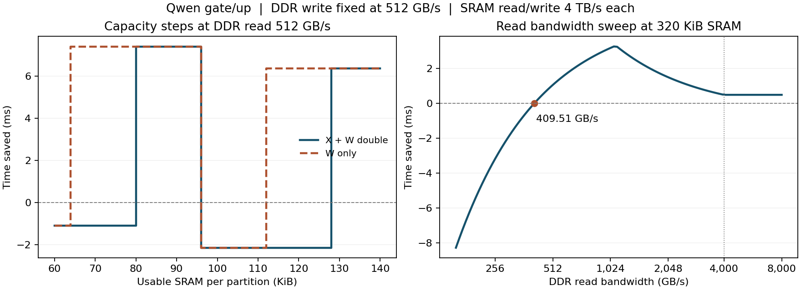

# 固定 SRAM 下的单缓冲与双缓冲

以 Qwen2.5-7B 的一层 gate/up 投影作控制实验，形状为 $[2048,3584][3584,37888]$。同一行比较使用相同的容量、端口和引擎，分别为输入 $X$ 和权重 $W$ 选择 1 或 2 个槽位。下文时间单位为 ms，均为模型值。逐块模型对应原报告的输出块驻留、输入板流式加载策略，显式计入填充、排空、输出回写和可重叠的输入搬运。原报告中融合、条带驻留和全步所有算子的时间另有适用范围。[原模型](inference_resource_model.md) · [对照脚本](scripts/pingpong_tradeoff.py)

## 1. 把容量代价落实到发生重读的维度

本节的矩阵乘是 $Y=XW$。$X[M,K]$ 是激活，$M$ 为 token 行数，$K$ 为每行输入特征数。$W[K,N]$ 是权重，$N$ 为输出特征数。一个输出块（tile）覆盖 $Y$ 的 $m$ 行、$n$ 列。为算完其中一个元素要沿完整的 $K$ 维做点积，每次只取 $k$ 个位置；这次取出的 $m\times k$ 输入和 $k\times n$ 权重称为一对内积板（panel）。同一输出块会接收多对板，前一对的部分和要保留给后一对。

令 $m,n,k$ 分别为输出行块、输出列块、内积块宽，$s_X,s_W\in\{1,2\}$。BF16 输入、权重和输出，FP32 部分和驻留共享 SRAM。每个执行分区可用容量为 $C$，已扣除常驻元数据、其他并发任务的份额。该数据流满足

$$
S=4mn+2k(s_Xm+s_Wn)\le C.
$$

对 $[M,K][K,N]$，输入板按固定循环次序装入，分别累计 DDR 读取 $D_r$ 和写入 $D_w$：

$$
D_r=2MK\lceil N/n\rceil+2KN\lceil M/m\rceil,\qquad D_w=2MN.
$$

- 项：$4mn$；计的是什么：常驻 SRAM 的输出部分和；为什么这样乘：每个输出位置存 1 个 4 B 的 FP32 累加值，共 $mn$ 个。
- 项：$2kms_X$、$2kns_W$；计的是什么：所有激活槽、所有权重槽的 SRAM 占用；为什么这样乘：两种板分别有 $mk$、$kn$ 个 BF16 元素，每个 2 B。乘以各自的槽数；槽数为 2 时，当前板和下一板可同时存在。三项相加为峰值占用 $S$，须小于或等于可用字节 $C$。
- 项：$2MK\lceil N/n\rceil$；计的是什么：从 DDR 读入的激活字节；为什么这样乘：全部 $X$ 读一次是 $2MK$ B。输出每换一组 $n$ 列，按本节的循环顺序重新用到全部 $X$；不足一组的尾列也要访问，故遍历次数向上取整。
- 项：$2KN\lceil M/m\rceil$；计的是什么：从 DDR 读入的权重字节；为什么这样乘：全部 $W$ 为 $2KN$ B，每处理一组新的 $m$ 行，就再遍历一次权重。
- 项：$2MN$；计的是什么：向 DDR 写出的最终结果；为什么这样乘：$MN$ 个 BF16 元素各写一次。部分和在 SRAM 内更新，未计入这笔片外流量。写回仅计入 $D_w$。

第一个输入沿 $n$ 列复用，一个权重沿 $m$ 行复用。缩小 $m$ 会在 $\lceil M/m\rceil$ 增大时增加权重读取，缩小 $n$ 类似地增加输入读取。在边界区间内 tile 变小也可能保持相同的遍历次数。缩小 $k$ 可以保持两个外层复用维度，但部分和经 SRAM 取回、写回的额外流量是 每方向 $4MN(\lceil K/k\rceil-1)$。对相同 $m,n,k$，分配额外槽位本身不改变 DDR 流量。

例如 $m=n=256,k=64$，256 KiB 为输出累加块，X 与 W 每板各 32 KiB。一个槽位、单操作数双槽、两个操作数双槽分别占 320、352、384 KiB。320 KiB 若改用 $k=32$，双槽也能保留 $256\times256$ 的输出块。其 DDR 仍为读 4.345 GB、写 0.155 GB，但 SRAM 读流量从 21.571 增至 38.953 GB，写流量也从 21.571 增至 38.953 GB，内积板从 56 个增至 112 个。在原模型的离散候选集里允许 $k=32,64,128$ 时，这个 320 KiB 双槽方案耗时 10.156 ms，单槽最优为 14.202 ms。

设 $D_X,D_W,D_Y$ 为上式三项，$D_r=D_X+D_W$、$D_w=D_Y$、$D=D_r+D_w$（仅用于核对字节），$A=4MN(\lceil K/k\rceil-1)$ 为相邻板之间交接的部分和字节。整层 **SRAM 读** 为 $(D_X+D_W+A)_{\rm engine}+ (D_Y)_{\rm DMA}$，**SRAM 写** 为 $(D_X+D_W)_{\rm DMA}+(A+D_Y)_{\rm engine}$。两者在此数据流下都等于 $D+A$，但事件的发生时刻和发起者不同，应分方向、分阶段计时。$3584/64=56$ 板，改用 $k=32$ 后有 112 板，每多一个边界都增加一次 FP32 写和一次 FP32 读。

## 2. 从硬件参数直接计算净收益

**外部输入。** 算子形状 $[M,K][K,N]$、各张量的元素字节宽度 $b_X,b_W,b_Y$；DDR 读带宽、读启动延迟 $B_{Dr},\ell_{Dr}$，写带宽、写启动延迟 $B_{Dw},\ell_{Dw}$；DMA 带宽和启动延迟 $B_A,\ell_A$；共享 SRAM 的可用容量、读带宽与读启动延迟 $B_R,\ell_R$、写带宽与写启动延迟 $B_W,\ell_W$，容量记作 $C$；Tensor 吞吐和启动延迟 $P_T,\ell_T$；Vector 各操作通路的元素吞吐和启动延迟 $P_{V,u},\ell_{V,u}$。统一使用 B、B/s、FLOP/s、元素操作/s 和秒。若规格给位宽，先除以 8。部分和固定为 FP32，即每元素 4 B。下文的板宽、计数、字节量和时间均由这些输入推导；槽位数取待比较方案的固定值。

**执行约定。** SRAM 读和写可同时达到各自的持续速率；同一时窗内同方向的请求共享该方向的带宽。基线选读 4 TB/s、写 4 TB/s，两者可独立修改，作为缺少目标芯片指标时的对称设计点。板内引擎计算与端口服务按流式重叠估计；输入在当前板消费完成时释放，输出块之间串行写回。待搬入的一组操作数计一次逻辑 DMA，拆成提前搬入和补载则分别启动。DDR 两方向分别使用各自的持续速率和启动延迟。单 DMA 在分阶段调度中执行输入或输出传输；输入路径使用 DDR 读和 SRAM 写，输出路径使用 SRAM 读和 DDR 写。DDR 读写参数可独立标定；同时混合读写时若有物理总线换向或共享控制器限制，需另用该负载下的有效值。该模型给出阶段级理想时间，bank 冲突、突发与拍级数据依赖需另行标定。

### 2.1 单块的尺寸、字节和计算时间

选输出 tile $(m,n)$、内积板宽 $k$。输出块从下标 $(a,b)$ 开始，下标分别以 $m,n$ 为步长遍历；其真实尺寸 $r=\min(m,M-a),\ c=\min(n,N-b)$。板数 $h=\lceil K/k\rceil$，第 $j$ 板宽 $v_j=\min(k,K-(j-1)k)$，$j=1,\dots,h$。输入和最终输出的字节数为

$$
x_j=b_Xrv_j,\qquad w_j=b_Wv_jc,\qquad z_j=x_j+w_j,\qquad y=b_Yrc.
$$

下标 $a,b$ 是输出块左上角的行、列坐标，从 0 起；$M-a,N-b$ 是还剩多少行、列，因此用 $\min$ 截断边界。板号 $j$ 从 1 起，前面已消费 $(j-1)k$ 个内积位置。比如 $K=65,k=64$ 时 $h=2$、$v_1=64,v_2=1$。$x_j,w_j$ 分别是两个输入切片的**实际元素数乘各自的字节宽度**；$z_j$ 是本板逻辑输入搬入量；$y$ 是整个输出块算完后的写出量，沿 $K$ 只写一次。

对槽数策略 $s=(s_X,s_W)$，单槽、仅 X 双槽、仅 W 双槽、两者双槽依次为 $(1,1),(2,1),(1,2),(2,2)$。可行条件和全矩阵的 DDR 流量分别是

$$
S_s=mn\max(4,b_Y)+k(s_X b_Xm+s_W b_Wn)\le C,\qquad
D_r=b_XMK\lceil N/n\rceil+b_WKN\lceil M/m\rceil,\quad D_w=b_YMN.
$$

输出缓冲与累加块复用。更小的 $m$ 或 $n$ 可能提高上述向上取整的遍历次数。只改 $k$ 时 DDR 字节不变，但内积板数和部分和读写会变。当前板需要 $2rcv_j$ FLOP；其引擎侧 SRAM 字节包括输入、前板部分和的读、本板部分和或最终输出的写：

$$
R_j=z_j+4rc\,\mathbf1_{j>1},\qquad W_j=4rc\,\mathbf1_{j<h}+y\,\mathbf1_{j=h}.
$$

$R_j,W_j$ 分别是引擎在第 $j$ 板读出、写入 SRAM 的字节。输入 $z_j$ 始终由引擎读。非首板读前板的 FP32 部分和；非末板写本板的 FP32 部分和；末板改写 $y$ B 最终结果。指示函数在条件成立时为 1，否则为 0。DMA 的装入和回写在下表另行计数。输出与累加块复用，故容量按 $\max(4,b_Y)$ B/位置分配。
 
- 访问事件：DMA 装入 X/W（含预取）；DDR 读 B：$z_j$；DDR 写 B：0；SRAM 读 B：0；SRAM 写 B：$z_j$
- 访问事件：Tensor 取 X/W、旧部分和；DDR 读 B：0；DDR 写 B：0；SRAM 读 B：$R_j$；SRAM 写 B：0
- 访问事件：Tensor 写新部分和或最终结果；DDR 读 B：0；DDR 写 B：0；SRAM 读 B：0；SRAM 写 B：$W_j$
- 访问事件：DMA 回写最终输出；DDR 读 B：0；DDR 写 B：$y$；SRAM 读 B：$y$；SRAM 写 B：0

定义 $H_d(x)=0$（$x=0$），否则 $H_d(x)=\ell_d+x/B_d$，$d=R,W$。没有访问的方向不计启动延迟。

定义 $B_{\rm in}=\min(B_{Dr},B_A,B_W)$、$B_{\rm out}=\min(B_{Dw},B_A,B_R)$。对非空传输，装入与写回的耗时为

$$
L_{\rm in}(z)=\ell_{Dr}+\ell_A+\ell_W+z/B_{\rm in},\qquad
L_{\rm out}(y)=\ell_{Dw}+\ell_A+\ell_R+y/B_{\rm out}.
$$

$$
E_j=\max\!\left(\ell_T+\frac{2rcv_j}{P_T}, H_R(R_j), H_W(W_j)\right).
$$

$L_{\rm in}(0)=L_{\rm out}(0)=0$。输入沿 DDR → DMA → SRAM 写端口，输出沿 SRAM 读端口 → DMA → DDR。路径启动截距相加，持续速率取最慢环节。

$E_j$ 同时受 Tensor、SRAM 读、SRAM 写三项约束。$rc$ 个点积片段，每个做 $v_j$ 次乘加，每次 2 FLOP。纯 gate/up 投影不使用 Vector。

### 2.2 首板、稳态、尾板与净收益

对于 $j<h$，下一板能在本板计算时预取的字节，以及必须等单槽释放后补载的字节为

$$
p_{j+1}=(s_X-1)x_{j+1}+(s_W-1)w_{j+1},\qquad u_{j+1}=z_{j+1}-p_{j+1}.
$$

当前板执行时预取 $p$ B，只会增加写端口负荷。流式并发窗口为

$$
J_j(p)=\max\!\left(E_j,L_{\rm in}(p), H_W(W_j+p)\right).
$$

$(s_X-1),(s_W-1)$ 是提前装入的开关，单槽为 0、双槽为 1。$u_{j+1}$ 是释放单槽后补载的剩余字节。$J_j$ 已通过 $E_j$ 包含 $H_R(R_j)$；DMA 写 ping/pong 不消耗读带宽。写竞争只发生在引擎写 $W_j$ 与 DMA 写 $p$ 之间，一个并发时窗的端口启动截距按一次计。

**一个边界到底省了什么？** 对全双槽令 $L=L_{\rm in}(z_{j+1})$、$E=E_j$、$Q=H_W(W_j+z_{j+1})$。单槽串行用 $E+L$，双槽并发用 $\max(L,E,Q)$。

$$
o_j=L+E-\max(L,E,Q)=\min\{L,E,L+E-Q\}.
$$

若 $E$ 最大，省下全部 $L$；若 $L$ 最大，省下全部 $E$；若 $Q$ 最大，写端口排队使收益只剩 $L+E-Q$。右端的最小值来自用同一串行时间分别减去三个约束。$o_j$ 是一个可重叠边界的局部收益。将不同 tile 的整层方案作比较时还要计入重读与首尾；在仅一个操作数双槽且存在启动延迟时，分开预取和补载还可能多启动一次 DMA。
这是允许端口按需交错且没有额外 bank 冲突的流体近似。预取要等 DMA 启动；$L_{\rm in}(p)$ 保留这一时间。单槽时 $p=0$，自动有 $J_j(0)=E_j$。一个输出块的总时间为

$$
\boxed{\tau_s=L_{\rm in}(z_1)+
\sum_{j=1}^{h-1}\!\big[J_j(p_{j+1})+L_{\rm in}(u_{j+1})\big]+E_h+L_{\rm out}(y).}
$$

首板全部装入后开始计算；每个中间边界只允许双槽部分提前装入；最后一板只计算并写回。若 $h=1$，中间求和为空，同一 tile 的单双槽时间相等。全双槽且各板等长时，每个有效边界能省下 $E_j+L_{\rm in}(z_{j+1})-J_j(z_{j+1})$，其值由物理参数算出。

给定相同容量，各策略在所有允许的整数 tile 中独立最小化时间。默认数学域为 $1\le m\le M,\ 1\le n\le N,\ 1\le k\le K$；复算既有表格时用其固定 tile 网格和 $k=64$。

$$
T_s^*(C)=\min_{m,n,k:\,S_s\le C}\sum_{a,b}\tau_s(a,b;m,n,k),\qquad
\boxed{G_s(C)=T_{(1,1)}^*(C)-T_s^*(C).}
$$

$G_s>0$ 表示节省时间；延迟降幅为 $G_s/T_{(1,1)}^*$，加速比为 $T_{(1,1)}^*/T_s^*$。若方案没有任何可行 tile，则该方案不可选。此表达式已经计入 DDR 重读、DMA 启动、Tensor 计算、SRAM 端口争用和首尾开销。额外的同步协议若需新的硬件定时规格，现有输入只能给出上述约定下的分析估计。

$\tau_s$ 的求和下标 $1,\ldots,h-1$ 枚举相邻板边界，因此首板的 $L_{\rm in}(z_1)$、末板的 $E_h$ 和回写 $L_{\rm out}(y)$ 必须单列；中间每个 $L_{\rm in}(u_{j+1})$ 是没有预取的剩余负担。$T_s^*(C)$ 中 $\sum_{a,b}$ 遍历整张输出矩阵的所有块，$\min$ 从容量允许的方案中选最快的，星号表示这个最优值。$G_s$ 的单位与 $T$ 相同；用它除以单槽时间才是延迟降低比例，用单槽时间除以方案时间则是倍数。例如 14.20224 → 13.14016 ms 分别对应 1.06208 ms、7.48%、1.081 倍。

### 2.3 具有 Vector 阶段的具体例子

以 gate/up 后的 **SwiGLU** 为例，算子语义固定为 $Y=g\,u/(1+\exp(-g))$。对长 $v$ 的连续 tile，输入为 $v$ 个 gate 和 $v$ 个 up，每元素宽 $b_g,b_u$；输出每元素宽 $b_o$。按符号取反融合到 exp 输入、其余依赖阶段顺序执行的映射，每元素做一次 exp、一次 add、一次 reciprocal、两次 mul。定义 $V_f(v)=\ell_{V,f}+v/P_{V,f}$。假定片内中间值保存在 Vector 寄存器，连续行之间可流式供数，单板计算时间可写成

$$
E_j^V=\max\!\left(V_{\exp}(v)+V_{\rm add}(v)+V_{\rm inv}(v)+2V_{\rm mul}(v),
H_R((b_g+b_u)v), H_W(b_o v)\right).
$$

为输入各开 $s_g,s_u$ 个槽，输出单槽另占 $b_o v$；峰值约束为 $(s_g b_g+s_u b_u+b_o)v\le C$。逐板令 $z_j=(b_g+b_u)v_j,\ y_j=b_o v_j,\ R_j=z_j,\ W_j=y_j$，以 $E_j^{V}$ 替换 $E_j$，再按实际依赖计时。具体地，若输出写回与下一板补载都串行，长度为 $h$ 板的 Vector 算子时间为

$$
L_{\rm in}(z_1)+\sum_{j=1}^{h-1}\big[J_j(p_{j+1})+L_{\rm out}(y_j)+L_{\rm in}(u_{j+1})\big]+E_h^V+L_{\rm out}(y_h).
$$

这里每板产出一批完整元素，因此每板都写回；GEMM 仅末板产出完整输出。若该 Vector 算子独立跟在投影之后且只改变投影槽数，它的时间在两方案作差时抵消。

SwiGLU 式中，$v$ 是一板输出位置数，$g,u$ 分别取自 gate 和 up 两个输入；这里的 $u$ 是激活值。$V_f(v)$ 由启动一次指令的 $\ell_{V,f}$ 和处理 $v$ 个元素的 $v/P_{V,f}$ 构成。按所选映射，exp 后加 1、取倒数，再与两个输入因子相乘，两次乘法各计一次启动和持续时间。$b_g,b_u,b_o$ 是这三路的 B/元素。引擎对每个位置读两路、写一路，故读端口承担 $(b_g+b_u)v$ B，写端口承担 $b_o v$ B。容量式给 gate、up 各预留 $s_g,s_u$ 份，结果另占一份。对尾板把 $v$ 换成实际位置数 $v_j$；两输入字节和为 $z_j$，该板结果是 $y_j$。在向量总时间公式中，$J_j$ 使用本板的 $E_j^V$ 和 $R_j,W_j$，接着先写 $y_j$，再补载 $u_{j+1}$；最后一板执行和写出分别为 $E_h^V,L_{\rm out}(y_h)$。这是一种明确的串行写回调度。

## 3. 既有单层算例与新公式的对应关系

### 3.1 用一层 GEMM 对账

下表是零启动延迟的理想特例，取 $B_{Dr}=B_{Dw}=512$ GB/s、$B_R=B_W=4$ TB/s、$P_T=128$ TFLOP/s，DMA 足以承接两方向，最后一行 DDR 读、写各 160 GB/s。脚本也支持 GEMM 的独立 DMA 带宽、非零 DDR/DMA/SRAM/Tensor 启动延迟和元素宽度。Vector 另按第 2.3 节的算子表达式计算。

- SRAM：64 KiB；单槽 DDR 读 GB / ms：13.0359 / 33.310；两路双槽 DDR 读 GB / ms：17.3812 / 34.406；各方案 DDR 写 GB：0.1552；仅 W 双槽 ms：25.900；条件：原模型二次幂候选
- SRAM：320 KiB；单槽 DDR 读 GB / ms：4.3453 / 14.202；两路双槽 DDR 读 GB / ms：6.5179 / 13.140；各方案 DDR 写 GB：0.1552；仅 W 双槽 ms：13.140；条件：原模型二次幂候选
- SRAM：352 KiB；单槽 DDR 读 GB / ms：4.3453 / 14.202；两路双槽 DDR 读 GB / ms：6.5179 / 13.140；各方案 DDR 写 GB：0.1552；仅 W 双槽 ms：10.044；条件：原模型二次幂候选
- SRAM：512 KiB；单槽 DDR 读 GB / ms：4.3453 / 14.202；两路双槽 DDR 读 GB / ms：4.3453 / 8.887；各方案 DDR 写 GB：0.1552；仅 W 双槽 ms：10.044；条件：原模型二次幂候选
- SRAM：320 KiB；单槽 DDR 读 GB / ms：4.3453 / 14.202；两路双槽 DDR 读 GB / ms：5.0353 / 10.238；各方案 DDR 写 GB：0.1552；仅 W 双槽 ms：9.989；条件：每 16 行/列一个候选
- SRAM：64 KiB；单槽 DDR 读 GB / ms：11.7734 / 81.790；两路双槽 DDR 读 GB / ms：14.4892 / 91.670；各方案 DDR 写 GB：0.1552；仅 W 双槽 ms：81.478；条件：每 16 行/列一个候选，DDR 读、写各 160 GB/s

**320 KiB 校核。** 在原网格中，单槽 $256\times256$ 的时间为 14.20224 ms，两路双槽 $128\times256$ 的时间为 13.14016 ms，故 $G=+1.06208$ ms。后者多读 2.17265 GB 权重，但逐板并发窗口缩短的时间足以抵消重读；64 KiB、DDR 读、写各 160 GB/s 的末行则为 $81.790-91.670=-9.880$ ms。二者的符号均由带宽、维度、容量与执行顺序决定。真实设备的非零启动延迟应代入 $L,E,J$ 重新选块。

放宽为 16 粒度后，320 KiB 的双槽选择 $208\times240$，仅 W 双槽选择 $208\times272$。两种方案的 DDR 读分别为 5.035 与 4.771 GB，写均为 0.155 GB；后者虽然少预取一个操作数，却以更少的重读取得更短时间。带宽较低的末行中，双槽即使取得全部可重叠时间，仍无法补回 DDR 重读成本。

表中“DDR 读 GB / ms”斜线两边是同一方案的累计读量（GB）和投影延迟（ms）。以 320 KiB 原网格为例，$X$ 一份是 $2\times2048\times3584$ B，$W$ 一份是 $2\times3584\times37888$ B，$Y$ 一份是 $2\times2048\times37888$ B。代入第 1 节的流量公式，单槽读 X **148 遍**（列块数），读 W **8 遍**（行块数），写 Y **1 遍**，即 DDR 读 4.34530 GB、写 0.15519 GB。双槽读 X 仍是 148 遍，但 W 要读 **16 遍**，因此读 6.51795 GB、写 0.15519 GB。按第 2 节逐块求和，双槽采用的小 tile 若串行搬入并计算需 18.97916 ms，板间并发共省 5.83900 ms。相对单槽的净收益为 $5.83900-(18.97916-14.20224)=1.06208$ ms。末行同理比较同一硬件上的绝对时间，负号表示较小 tile 导致的负担已超过重叠收益。

### 3.2 Online softmax：从跨块分母到 DMA 时间线

**先验算结果。** 取一行四个 FP32 分数，分成 A 板 $[0,1]$ 和 B 板 $[2,3]$。目标是输出四个概率。第一遍只维护两个标量：$m$ 是目前看过的最大分数，$d$ 是以这个最大值为基准的指数和。对新板 $\mathcal B$（其中 $x$ 为一个分数），更新式为

$$
m'=\max(m,\max_{x\in\mathcal B}x),\qquad
d'=\underbrace{e^{m-m'}d}_{\text{把旧分母换到新基准}}
   +\underbrace{\sum_{x\in\mathcal B}e^{x-m'}}_{\text{新板的贡献}} .
$$

撇号表示消费新板后的状态。旧分母中每项原为 $e^{x-m}$，乘 $e^{m-m'}$ 后恰好成为 $e^{x-m'}$，所以两部分可以相加。第一板直接用本板最大值初始化，省去空历史的乘法。[Online normalizer 原论文](https://arxiv.org/abs/1805.02867)

- 已处理的板：A：$[0,1]$；最大值 $m$：1；旧分母换基准：0；新板指数和：$e^{-1}+1$；更新后的 $d$：1.367879
- 已处理的板：B：$[2,3]$；最大值 $m$：3；旧分母换基准：$e^{1-3}\times1.367879=0.185122$；新板指数和：$e^{-1}+1=1.367879$；更新后的 $d$：1.553002

最终每个概率为 $p_i=e^{x_i-3}/1.553002$，逐项得到 **[0.032059, 0.087144, 0.236883, 0.643914]**。它们与直接对整行减去 3 后计算 softmax 一致。第一板自身的指数和虽也是 1.367879，却和第二板相差一个 $e^{-2}$ 的尺度；直接相加会把第一板权重算大。单独输出完整概率向量还要在最终 $m,d$ 已知后再读各分数，这是下文的第二遍。

**再给同一个例子加上物理参数。** 固定每板 2 个元素，比较相同块大小的单双槽调度。两种方案均采用“两遍从 DDR 读分数”的实现，输出板与输入板分配独立缓冲，每次 8 B。单槽共占 16 B，双槽共占 24 B，给两者相同的 24 B 可用 SRAM。标量 $m,d$、倒数和临时算术值驻留引擎寄存器。假设 $B_{Dr}=B_{Dw}=B_A=2$ GB/s、$B_R=B_W=2$ GB/s、启动延迟为零，各 Vector 基本操作均为 1 G 元素操作/s。板内依赖操作取串行服务时间，读入寄存器后做算术；沿用第 2 节对板级供数的流式近似。下面的时间是便于手算的分析值。具体实现若将整行留在片上，可省掉第二次片外读取，应单独比较。

1. **第一遍 A 板。** 装入 8 B 是 DMA 写 SRAM，$L_{\rm in}=8/2=4$ ns。引擎读 8 B、写 0 B；板内比较 1 次、减法和 exp 各 2 次、加法 1 次。$E_A=\max(6,8/2,0)=6$ ns。预取 B 板写 8 B，独立端口同时服务 8 B 读与 8 B 写，$Q=8/2=4$ ns。节省 $4+6-\max(4,6,4)=4$ ns。
2. **第一遍 B 板。** A 板结束后，才可用其 $m,d$ 更新历史状态。求新最大值要 2 次比较（板内一次、与旧最大值一次）；旧分母重标定需减、exp、乘各一次；新板需 2 次减、2 次 exp、1 次加，再加 1 次把新旧两项合并，共 $2+3+2+2+1+1=11$ 个操作，$E_B=\max(11,8/2)=11$ ns。单槽第一遍时间线为 **0–4 装 A，4–10 算 A，10–14 装 B，14–25 算 B**。双槽为 **0–4 装 A，4–10 算 A（4–8 同时装 B），10–21 算 B**。预取 B 可以提前，消费 A 状态的那一步仍等到 10 ns。
3. **第二遍输出概率。** 两方案先花 1 ns 求倒数。每板读 8 B 分数、写 8 B 概率到 SRAM，算术为两组减、exp、乘。$E=\max(6,8/2,8/2)=6$ ns。预取同时再向写端口送 8 B，$Q=(8+8)/2=8$ ns；读端口仍只需 4 ns。这一边界省 $4+6-8=2$ ns。DMA 从 SRAM 读 8 B 回写结果花 $L_{\rm out}=4$ ns。单槽第二遍为 $1+2(4+6+4)=29$ ns，双槽为 $1+4+8+4+6+4=27$ ns。

整个 softmax 的固定分块结果为 **单槽 54 ns、双槽 48 ns，节省 6 ns**。两种方案都从 DDR 读 $2\times4\times4=32$ B（两遍、四个分数、每个 4 B），写 $4\times4=16$ B 概率。SRAM 的读量为引擎读 32 B 加 DMA 读 16 B，写量为 DMA 写 32 B 加引擎写 16 B，两方向各 48 B。6 ns 的收益来自第一遍的 4 ns 与第二遍的 2 ns。这里演示的是第 2 节的同 tile 局部重叠公式；若要报告第 3.1 节那样的最优策略收益，还须对每个槽数重新搜索块长及驻留方式。

## 4. 收益拐点出现在哪里

本节计算一个 Transformer 层中的 gate/up 联合投影 $Y=XW$。$X$ 是本轮输入激活，$W$ 是两路投影拼接后的权重，$Y$ 的每行对应一个 token，列包含 gate 和 up 两组输出。表中 ms 是**一次完整投影**的时间。4.2 节中 ns 是**一个内积板**的时间，两种计时范围之间还隔着板数、输出块数、流水首尾和输出写回。

- 符号：$M,K,N$；单位和本节默认值：元素数，分别为 2,048、3,584、37,888；在计算流中的含义：$X$ 有 $M$ 行、$K$ 列，$W$ 有 $K$ 行、$N$ 列；输出有 $M$ 行、$N$ 列。$K$ 是每个输出点积的完整长度。
- 符号：$m,n,k$；单位和本节默认值：元素数，默认 $k=64$；在计算流中的含义：一个输出块覆盖 $m$ 行和 $n$ 列；为得到它，每次取 $X$ 的 $m\times k$ 板与 $W$ 的 $k\times n$ 板相乘，再沿 $K$ 累加。尾块用实际尺寸计时。
- 符号：$b_X,b_W,b_Y$；单位和本节默认值：B/元素，默认各 2；在计算流中的含义：对应激活、权重和最终输出的存储宽度，BF16 为 2 B，FP32 部分和为 4 B。
- 符号：$C,s_X,s_W$；单位和本节默认值：$C$ 用 B；$s_X,s_W$ 是槽数；在计算流中的含义：$C$ 是本执行分区能分配给这个算子的 SRAM。槽数 1 表示在当前板释放后重装，2 表示可用另一槽提前装下一板。表中“仅 W 双槽”取 $(1,2)$。
- 符号：$B_{Dr},B_{Dw},B_A,B_R,B_W$；单位和本节默认值：B/s；DDR 读、写各 512 GB/s，SRAM 读、写各 4 TB/s；在计算流中的含义：依次为 DDR 读、DDR 写、DMA、SRAM 读、SRAM 写持续速率；DMA 默认足以承接实际方向。
- 符号：$\ell_{Dr},\ell_{Dw},\ell_A,\ell_R,\ell_W,\ell_T$；单位和本节默认值：s；基线为 0；在计算流中的含义：分别为 DDR 读、DDR 写、DMA、SRAM 读、SRAM 写与 Tensor 的逻辑服务启动延迟。一个方向字节数为零时该方向没有服务。
- 符号：$P_T$；单位和本节默认值：FLOP/s；默认 128 TFLOP/s；在计算流中的含义：Tensor 在所选精度下的持续运算速率，一次乘加计 2 FLOP。Vector 算例改用各指令的元素吞吐。

定义 $G=T_{\rm single}^*-T_{\rm double}^*$。$T_{\rm single}^*$ 是单槽在给定 $C$ 下遍历合法 tile 后的最短投影时间，$T_{\rm double}^*$ 是 X、W 均双槽时独立选块的最短时间，星号表示在该候选集内取最小值。相减得到每次投影节省的毫秒数；$G>0$ 表示双槽快，$G<0$ 表示单槽快，$G=0$ 才是盈亏平衡。新 tile 放得下或最慢资源换手也会产生拐点，此时 $G$ 可以仍为正。下文沿用原模型二次幂输出 tile 候选及实际尺寸端点。容量 $1\ {\rm KiB}=1024$ B，速率 $1\ {\rm GB/s}=10^9$ B/s；因此使用字节和 GB/s 相除时，数值直接得到 ns。



### 4.1 容量台阶与输入、输出块大小

先列出必须同时留在 SRAM 内的三份数据。$b_C=\max(4,b_Y)$ 表示每个输出位置预留的字节数：计算中保存 4 B 的 FP32 部分和，最后在同一空间写 $b_Y$ B 的最终结果，按两者较宽的格式分配。容量约束为

$$
\underbrace{b_Cmn}_{\text{一块输出或部分和}}+
\underbrace{s_Xb_Xmk}_{\text{所有 X 输入槽}}+
\underbrace{s_Wb_Wkn}_{\text{所有 W 权重槽}}\le C.
$$

固定 $m,k$ 时，X 输入槽已占去 $s_Xb_Xmk$ 字节；输出每多一列，要再存 $m$ 个结果（$b_Cm$ B），并为每个 W 槽再存 $k$ 个权重（共 $s_Wb_Wk$ B）。因此“剩余字节数 ÷ 每增加一列的字节数”给出最大列数：

$$
n_{\max}=\min\!\left(N,\left\lfloor\frac{C-s_X b_Xmk}{b_Cm+s_Wb_Wk}\right\rfloor\right).
$$

向下取整 $\lfloor\cdot\rfloor$ 保证能放下完整的一列，外层 $\min(N,\cdot)$ 将块宽限制在矩阵的实际列数内。若结果小于 1，该行块不可行；否则选不超过 $n_{\max}$ 的合法候选。这里 $n_{\max}$ 是容量上限，最快候选还需比较耗时。

把 $N$ 列按每块 $n$ 列切开，共有 $\lceil N/n\rceil$ 个列块，尾部不足 $n$ 列也需一次。按本节循环次序，每个列块重新遍历一遍 $X$。若最多允许读 $u$ 遍（$u$ 为正整数），由 $\lceil N/n\rceil\le u$ 得 $n\ge\lceil N/u\rceil$。取满足条件的最小合法列块 $n'$，代回三项容量之和，就得到所需的门槛 $C'=b_Cmn'+k(s_X b_Xm+s_Wb_Wn')$。撇号表示为这次复用目标选定的列数及相应容量。权重同理，每换一个行块重读一遍 $W$，遍历次数为 $\lceil M/m\rceil$。只有新 tile 的总时间优于现有最优值，容量门槛才会反映到延迟上。

- 可用容量：80 KiB；单槽 ms：33.310；仅 W 双槽 ms：25.900；两路双槽 ms：25.900；两路双槽净省 ms：+7.410
- 可用容量：96 KiB；单槽 ms：23.756；仅 W 双槽 ms：25.900；两路双槽 ms：25.900；两路双槽净省 ms：−2.144
- 可用容量：112 KiB；单槽 ms：23.756；仅 W 双槽 ms：17.393；两路双槽 ms：25.900；两路双槽净省 ms：−2.144
- 可用容量：128 KiB；单槽 ms：23.756；仅 W 双槽 ms：17.393；两路双槽 ms：17.393；两路双槽净省 ms：+6.363

$128\times128$ 输出的部分和占 64 KiB，两块输入各占 16 KiB。单槽在 96 KiB 即可用这块，单操作数双槽需要 112 KiB，两路双槽需要 128 KiB。每种策略的最优耗时随容量增加均可保持或下降，两个最优耗时的差可以反复变号。这也是容量选型时要同时看绝对时间和相对收益的原因。

**位宽与输出回写。** 在 320 KiB 下，仅把 X、W 从 2 B 改为 1 B，保持算力和 FP32 累加约定，$256\times256$ 全双槽的门槛从 384 降到 320 KiB。单双槽都选该 tile，DDR 读均为 2.173 GB、写均为 0.155 GB，分别耗时 9.425 和 5.267 ms。这个算例隔离了表示宽度，未计低精度转换或解量化。当 $b_Y\le4$ 时，缩小输出位宽通常只减少最终写回及末板供数，FP32 部分和仍占 $4mn$。同样改动若使 $b_Y>4$，则 $b_C$ 也增大，可能压缩输入复用空间。单看输出总字节不足以区分这两种情形。

### 4.2 搬运、计算和独立读写端口的交点

在一个输出块内部，用 $j$ 表示当前正在计算的板，$j+1$ 表示将要预取的下一板。下面看两个输入都双槽、当前板和下一板都为完整板的情形：

- 时间：$L=L_{\rm in}(z_{j+1})$；各项从哪里来：下一板 X、W 共 $z_{j+1}=b_Xmk+b_Wkn$ B，由 DMA 写入 SRAM，输入速率 $B_{\rm in}=\min(B_{Dr},B_A,B_W)$。
- 时间：$E=\max(\ell_T+2mnk/P_T,H_R(R_j),H_W(W_j))$；各项从哪里来：对完整中间板，输入和旧部分和须读 $R_j=z_j+4mn$ B，新部分和须写 $W_j=4mn$ B。三个约束取最大值。
- 时间：$Q=H_W(W_j+z_{j+1})$；各项从哪里来：此窗口的写端口收到引擎写和 DMA 预取写；引擎读仍由 $H_R(R_j)$ 约束，已计在 $E$ 中。

单槽按“算完当前板，再装入下一板”执行，边界时间为 $E+L$。双槽允许两项并发，但窗口至少要满足搬运、执行和写端口三种服务需求；理想交错模型取三者的最大值。两种边界时间相减，即得到第 $j$ 个边界节省的时间 $o_j$：

$$
o_j=L+E-\max(L,E,Q)=\min(L,E,L+E-Q).
$$

右侧来自把 $L+E$ 分别减去三个候选并取最小值。若 $E$ 最长，省下完整的 $L$；若 $L$ 最长，省下完整的 $E$；若 $Q$ 最长，写端口只留下 $L+E-Q$ 的重叠空间。相邻板数为零时就没有这个窗口。整层还要累加所有边界，并计入首板装入、尾板计算和输出回写。

- **计算掩盖全部预取**需要 $L\le E$ 且 $Q\le E$。
- **搬运掩盖全部计算**需要 $E\le L$ 且 $Q\le L$。
- **写端口主导**发生在 $Q\ge\max(L,E)$，此时增加 DDR 读带宽 或 Tensor 峰值只能缩短各自暴露的部分。判定瓶颈换手使用两项相等且同时不小于第三项的边界。

零启动延迟、Tensor 主导引擎服务且两方向端口均有余量时，令 $B=B_{\rm in}$，等长内板的简单算术强度交点为

$$
\frac{P_T}{B}=\frac{2mnk}{b_Xmk+b_Wnk}=\frac{2mn}{b_Xm+b_Wn}.
$$

推导只用到两个时间相等：输入字节除以 $B$ 等于运算量除以 $P_T$。左侧 $P_T/B$ 表示硬件每搬入 1 B 数据有能力做多少 FLOP；右侧分子 $2mnk$ 是该板实际执行的 FLOP，分母两项是 X、W 各自搬入的字节，所以右侧是这块数据实际支持的 FLOP/B。等长满板下分子分母都含 $k$，可以约掉。部分和的读取进入 $E$，部分和的写入还与预取在 $Q$ 中争用写带宽。

取 $m=n=256,k=64$，算术强度为 128 FLOP/B。分别固定 Tensor 为 128 TFLOP/s 或固定 DDR 读带宽 为 512 GB/s，可以求两个不同方向的换手点。

$65{,}536=2\times256\times64+2\times64\times256$ B 为输入。中间板引擎读 $R_j=65{,}536+4\times256^2=327{,}680$ B，写 $W_j=262{,}144$ B。其读服务为 81.92 ns，写服务为 65.536 ns，Tensor 时间为 65.536 ns，所以 $E=81.92$ ns。并发时预取额外写入 65,536 B，写端口合计 327,680 B，$Q=81.92$ ns；读量仍为 327,680 B。DDR 读带宽 512 GB/s 时 $L=128$ ns。仅升 DDR 读带宽，在 **800 GB/s** 时 $L=E=Q$，读、写端口都到达瓶颈。固定 DDR 读带宽，Tensor 换手点为 $8{,}388{,}608\ {\rm FLOP}/128\ {\rm ns}=65.536$ TFLOP/s。若两方向带宽不同，须分别重算两项。

**Vector 算例。** SwiGLU 对每个输出位置计算 $g\,u/(1+\exp(-g))$。这里 $g,u$ 分别是 gate 和 up 的输入值；4.1 节的“遍历次数 $u$”只在容量推导中使用。$v$ 是一块中要生成的输出元素数，每个位置需分别读 $b_g,b_u$ 字节，故每元素总输入为 $b_i=b_g+b_u$。按第 2.3 节的指令映射，取反并入指数指令，依次计一次 exp、一次加 1、一次求倒数、两次乘法。对每个通路 $f$，$\ell_f$ 为一次向量操作启动的秒数，$P_f$ 为每秒处理的元素数。

- 公式项：$\lambda_L=\ell_{Dr}+\ell_A+\ell_W$；单位：s/板；推导与含义：读入一板 gate 和 up 时，片外访问、DMA、SRAM 写服务的合计启动时间。
- 公式项：$vb_i/B$；单位：s/板；推导与含义：$v$ 个位置共读 $vb_i$ 字节，除以有效输入路径带宽 $B=B_{\rm in}$；$b_i/B$ 是每增加一个元素的搬运时间。
- 公式项：$\lambda_V=\ell_{\exp}+\ell_{\rm add}+\ell_{\rm inv}+2\ell_{\rm mul}$；单位：s/板；推导与含义：顺序指令的启动时间相加。乘法执行两次，所以其启动项也出现两次。
- 公式项：$a_V=1/P_{\exp}+1/P_{\rm add}+1/P_{\rm inv}+2/P_{\rm mul}$；单位：s/元素；推导与含义：吞吐取倒数得到每元素服务时间，再按指令出现次数求和；乘以 $v$ 得处理整板的持续计算时间。

在算术路径主导且读、写端口均有余量时，令输入搬运时间 $\lambda_L+vb_i/B$ 等于向量执行时间 $\lambda_V+va_V$，把随 $v$ 变化的项移至同一侧得

$$
v_\times=\frac{\lambda_V-\lambda_L}{b_i/B-a_V}.
$$

下标 $\times$ 表示两条时间曲线相交。分子是两条路径的固定启动时间差（s），分母是新增一个元素时两条路径的耗时差（s/元素），两者相除给出元素数。若交点落在两个合法板长之间，比较两侧的实际板长。$b_o$ 是每个输出元素的字节数，$L_{\rm out}(b_ov)$ 是整板结果的回写时间；在这里，回写发生在上述并发窗口之后。

只有分母非零、解为正、落在可行尺寸内且读、写端口均未先限速时，此交点才有效。两端斜率相等时检查截距即可。逐块输出的 $L_{\rm out}(b_o v)$ 在该调度中暴露于串行写回；同 tile 下它会稀释百分比加速。输出尺寸与两端的启动次数共同作用，不能用一次 EXP 的吞吐代替整条依赖链。

### 4.3 整层 DDR 读带宽盈亏点与输入、输出路径饱和

固定 320 KiB、$B_R=B_W=4$ TB/s、$P_T=128$ TFLOP/s。固定 DDR 写 512 GB/s，只扫 DDR 读。对各点重新选 tile，并在读带宽 384～448 GB/s 的变号区间二分。

- DDR 读 GB/s（写固定 512）：384；单槽 ms：17.031；两路双槽 ms：17.384；净省 ms：−0.352
- DDR 读 GB/s（写固定 512）：约 409.51；单槽 ms：16.326；两路双槽 ms：16.326；净省 ms：0
- DDR 读 GB/s（写固定 512）：512；单槽 ms：14.202；两路双槽 ms：13.140；净省 ms：+1.062
- DDR 读 GB/s（写固定 512）：1,024；单槽 ms：9.959；两路双槽 ms：6.775；净省 ms：+3.184
- DDR 读 GB/s（写固定 512）：2,048；单槽 ms：7.837；两路双槽 ms：6.335；净省 ms：+1.502
- DDR 读 GB/s（写固定 512）：4,000；单槽 ms：6.802；两路双槽 ms：6.307；净省 ms：+0.495
- DDR 读 GB/s（写固定 512）：8,000；单槽 ms：6.802；两路双槽 ms：6.307；净省 ms：+0.495

在低读带宽交点附近，单槽选 $256\times256$，双槽选 $128\times256$。启动延迟为零，输入、输出各自受 DDR 的读、写速率限制。令 $\Delta D_r,\Delta D_w$ 为双槽相对单槽增加的读、写字节，$\Delta E$ 为各板执行时间之差，$O$ 为各相邻板的重叠收益之和。零启动且装入和回写串行的这一分支有

$$
G=O-\Delta E-\frac{\Delta D_r}{B_{Dr}}-\frac{\Delta D_w}{B_{Dw}},\qquad \Delta D_w=0.
$$

- 低带宽交点中的数值：$\Delta D_r=2.172649$ GB；计算来源：整套 gate/up 权重一份是 $2\times3584\times37888=271{,}581{,}184$ B。行块从 256 缩为 128 后，权重随 $2048/128=16$ 个行块读入；原来只读 $2048/256=8$ 遍，新增 $8\times271{,}581{,}184$ B。列块不变，激活读取次数相同，最终输出字节也相同。
- 低带宽交点中的数值：$\Delta E=0.533463$ ms；计算来源：分块改变了每板服务时间和板数。对单槽全部输出块与板累加 $E_j$，得到 5.412225 ms；双槽对应 5.945688 ms，差值是纯执行阶段新增的时间。每个 $E_j$ 已取 Tensor 与引擎侧 SRAM 读、写时间的最大值。
- 低带宽交点中的数值：$O=5.838995$ ms；计算来源：双槽较小的 tile 共产生 $16\times148=2368$ 个输出块（148 是 $37888/256$ 个列块）。每块有 $3584/64=56$ 个内积板、55 个相邻边界；按 4.2 节逐项累加这些边界实际可隐藏的时间。

两种方案都只写一次最终输出，故写时间在本次相减中抵消。令 $G=0$ 得 $\Delta D_r/B_{Dr}=O-\Delta E$；分母乘 $10^{-3}$ 将 ms 换成 s，求得整层 DDR 读带宽交点。

$$
B_{Dr}^\times=\frac{2.172649\ {\rm GB}}{(5.838995-0.533463)\times10^{-3}\ {\rm s}}\simeq409.51\ {\rm GB/s}.
$$

有效读带宽提到 4,000 GB/s 后，输入受 SRAM 写 $B_W$ 封顶，输出始终受固定的 DDR 写 512 GB/s 限制。DDR 读从 4,000 增至 8,000 GB/s，净收益均为 +0.495 ms。若 DDR 读 1,024 GB/s、写 512 GB/s、DMA 只有 400 GB/s，则装入与回写均被 DMA 限至 400 GB/s，净收益为 −0.126 ms。固定读 512 GB/s，仅把 DDR 写从 512 降至 256 GB/s，单、双槽都会多用 $0.155189248/256-0.155189248/512=0.000303104$ s，因输出字节相同且串行回写，净收益不变。

分方向的带宽扫描也会产生不同结果。固定写 4 TB/s，把读改为 1、2、8 TB/s，净省分别为 5.976、6.290、0.024 ms。固定读 4 TB/s，把写改为 1、2、8 TB/s，则分别为 1.858、4.282、1.062 ms。净收益是两种方案的时间差；每个扫描点的最优 tile 和每方向限制都需重新确定。读写各 4 TB/s 时，Tensor 为 32、64、128、256 TFLOP/s 分别净省 8.260、4.292、1.062、1.062 ms。

### 4.4 板数与启动延迟的交点

**数可重叠的边界。** 记 $h=\lceil K/k\rceil$ 为每个输出块的内积板数，向上取整是因为余下哪怕一个内积元素也要处理。最后一板的实际宽度为 $K-(h-1)k$：前 $h-1$ 板各覆盖 $k$ 个位置。每块的首板先装入，当前板能与下一板重叠，共有 $h-1$ 个相邻边界；末板之后要完成计算并写出整个输出块。例如 $K=513,k=64$ 时，第九板宽 $513-8\times64=1$，在相同输出块下，该板输入字节和 Tensor 运算量都只有完整板的 $1/64$，每次 DMA 的固定启动时间仍然存在。

保持 320 KiB 与 $k=64$，只改 $K$。$K=64$ 只有一板，双槽慢 0.076 ms；$K=320$（5 个完整板）仍慢 0.02000 ms，$K=384$（6 板）则快 0.00121 ms。$K=385$ 有一个宽度为 1 的尾板，快 0.00343 ms。$K=1024$ 时快 0.21339 ms。只改 $M$ 从 128 到 256，双槽净省从 0.365 降至 0.133 ms，单槽这时能选更大行块。

**一次搬运的字节门槛。** 输入写 SRAM：$z_{\lambda,\rm in}=B_{\rm in}(\ell_{Dr}+\ell_A+\ell_W)$；输出读 SRAM：$z_{\lambda,\rm out}=B_{\rm out}(\ell_{Dw}+\ell_A+\ell_R)$。各式均来自令该方向的启动时间等于有效字节除以路径带宽。载荷远小于本方向门槛时，收益更依赖减少启动次数。

**整层的 DMA 启动门槛。** 改回 $K=3584$，只扫描每次逻辑 DMA 的启动时间 $\ell_A$。下表说明如何从张量形状数出两个方案的总启动次数。

- 计数对象：输出块个数；单槽 $256\times256$：$(2048/256)(37888/256)=1184$；双槽 $128\times256$：$(2048/128)(37888/256)=2368$；含义：输出行块数 × 列块数。这组尺寸整除；有尾块时两个商各自向上取整。
- 计数对象：每块逻辑 DMA 数；单槽 $256\times256$：$56+1=57$；双槽 $128\times256$：$56+1=57$；含义：56 来自 $3584/64$ 个内积板，X 与 W 每板合计一次逻辑输入搬入；1 为最终输出块的一次回写。这里计启动次数，所以用 56 次装入；统计重叠窗口时用 55 个边界。

在该搬运限速分支上，每次启动延长的部分都体现在总时间上。双槽多出 $(2368-1184)\times57=67{,}488$ 次启动。当每次多 1 ns，全层双槽相对单槽多花 $67{,}488$ ns，即 $0.067488$ ms（1 ms 等于 $10^6$ ns）。在零启动时双槽领先 $14.202241-13.140165=1.062076$ ms。因此，只要该分支与选块仍有效，就有

$$
G\,[{\rm ms}]=1.062076-0.067488\,\ell_{A,{\rm ns}}.
$$

其中 $\ell_{A,{\rm ns}}$ 是按 ns 表示的每次 DMA 启动时间数值。令 $G=0$ 得 $1.062076/0.067488\simeq15.74$ ns/次；代入 25 ns 后单槽为 15.889 ms，双槽为 16.515 ms。若硬件将两个输入拆成多条描述符、合并连续输出或让启动与别的 tile 交错，需重算启动次数与可重叠窗口。

**复算方法。** 在本文目录执行下列命令。对相邻变号点二分时每次重新搜索合法 tile；容量扫描应检查各候选的确切占用阈值，避免等间隔采样漏掉狭窄台阶。

```bash
python3 -B scripts/pingpong_tradeoff.py --kib 80 96 112 128
python3 -B scripts/pingpong_tradeoff.py --kib 320 --ddr-read-gbs 409.5064
python3 -B scripts/pingpong_tradeoff.py --kib 320 --sram-read-gbs 2000 --sram-write-gbs 4000
python3 -B scripts/pingpong_tradeoff.py --kib 320 --dma-ns 15.7373
python3 -B scripts/pingpong_tradeoff.py --kib 320 --x-bytes 1 --w-bytes 1
```

## 5. FlashAttention 前向实例与四向带宽

### 5.1 计算范围、数据来源与片上布局

取 Qwen2.5-7B 的一个 Q 头，头维 $d=3584/28=128$ 来自公开配置。用 FA2 的按 Q 块扫描 KV、最后一次归一化的前向递推。为便于复算，算例选 **32 个 query 对 128 个全部可见的 key**，拆成两块各 64 个 key；算的是一个完整的无掩码 scaled dot-product attention 子问题。也可把这两块视为 causal prefill 中严格位于对角线左侧的前缀，若还有当前 chunk 的 KV，须先处理其余可见块才能最终归一化。这里给的是单头、单 Q tile 的延迟，不乘层数或头数；实际 GQA 能否跨 Q 头共用 KV 取决于调度。[Qwen 配置](https://huggingface.co/Qwen/Qwen2.5-7B-Instruct/raw/main/config.json) · [FlashAttention 原论文](https://arxiv.org/abs/2205.14135) · [FlashAttention-2 前向算法](https://arxiv.org/abs/2307.08691)

- 参数：激活与中间值；取值与来源：Q/K/V、块内未归一化权重 P 和最终 O 选 BF16（2 B）；score、局部 PV、历史分子和行状态为 FP32（4 B）。按选定映射统计 SRAM 搬运。
- 参数：片外与片内硬件；取值与来源：示例独立设置 DDR 读 512、写 256 GB/s，SRAM 读 4,000、写 4,000 GB/s，DMA 不额外限速。启动延迟取零。
- 参数：计算硬件；取值与来源：示例 Tensor 为 128 TFLOP/s；Vector 乘、加/减分别为 2,000 G 元素操作/s，max/sum 的二元归约为 1,000 G 操作/s，exp 为 250 G 元素/s，倒数为 125 G 元素/s。只在每个计算阶段内部重叠算术与 SRAM 供数，各阶段按依赖顺序执行。
- 参数：存活与调度；取值与来源：Q 在 SRAM 驻留，两组 KV 槽交替；score 与较窄的 P 共用 scratch，旧分子和新 PV 各有一块 FP32 缓冲。行最大值、分母及重标定因子常驻引擎寄存器。最终 O 复用 Q 缓冲。忽略地址、类型转换指令耗时、bank 冲突与调度启动。

令 $r=32,c=64$，每板有 $a=rc=2048$ 个 score，每个输出 tile 有 $f=rd=4096$ 个元素。Q 为 $2rd=8192$ B，一块 K 或 V 各 $2cd=16384$ B，所以一个 KV 对为 32768 B。峰值 SRAM 为 $8192+2\times32768+4a+2\times4f=114688$ B（112 KiB）。单槽同 tile 为 80 KiB。下文两种方案共同可用 112 KiB，固定 tile；分数与概率始终片上交接，DDR 只读 Q/K/V、写最终 O。逐步数值依据是这组形状、精度、算法和硬件假设。

### 5.2 单 KV 板做哪些运算？

按每个 query 行维护最大值 $m$、分母 $\ell$、未归一化向量分子 $U$。第 $j$ 个 KV 板的分数、块权重和局部输出依次为

$$
S_j=QK_j^\top/\sqrt d,\quad m'=\max(m,\operatorname{rowmax}S_j),\quad
P_j=\exp(S_j-m'),\quad Z_j=P_jV_j.
$$

更新 $\alpha=\exp(m-m')$，$\ell'=\alpha\ell+\operatorname{rowsum}P_j$，$U'=\alpha U+Z_j$。行标量在该行所有输出维度上广播。首板直接令 $\ell=\operatorname{rowsum}P_1,\ U=Z_1$，免去空历史的读写。末板输出 $O=U/\ell$。这里 $P_j$ 还没有除以分母；只在最后做一次归一化。表内矩阵乘按 2 FLOP/乘加计数；max/sum 每行 64 个输入各需 63 次二元操作。

### 5.3 逐步计算单槽时间

下表是实际执行次序。四个字节列按**访问的存储器和方向**分别登记。例如装入 KV 同时贡献 DDR 读和 SRAM 写。阶段延迟取相应服务时间的最大值。数值用 B、ns、GB/s，因此 B 除以 GB/s 直接得到 ns。

- 步骤：1. 装入 Q；DDR 读 B：8192；DDR 写 B：0；SRAM 读 B：0；SRAM 写 B：8192；单独执行 ns：16.000；数据或时间的来源：$8192/\min(512,4000)$
- 步骤：2. 装入 K1、V1；DDR 读 B：32768；DDR 写 B：0；SRAM 读 B：0；SRAM 写 B：32768；单独执行 ns：64.000；数据或时间的来源：$2\times16384/512$
- 步骤：3. $QK_1^\top$；DDR 读 B：0；DDR 写 B：0；SRAM 读 B：24576；SRAM 写 B：8192；单独执行 ns：6.144；数据或时间的来源：读 Q+K，写 $4a$ B score；详见下式
- 步骤：4. 首板 online softmax；DDR 读 B：0；DDR 写 B：0；SRAM 读 B：8192；SRAM 写 B：4096；单独执行 ns：14.272；数据或时间的来源：读 FP32 score，写 BF16 P；初始化行状态
- 步骤：5. $P_1V_1$，直接初始化 U；DDR 读 B：0；DDR 写 B：0；SRAM 读 B：20480；SRAM 写 B：16384；单独执行 ns：5.120；数据或时间的来源：读 $2a+2cd$，写 $4f$
- 步骤：6. 装入 K2、V2；DDR 读 B：32768；DDR 写 B：0；SRAM 读 B：0；SRAM 写 B：32768；单独执行 ns：64.000；数据或时间的来源：与步骤 2 同形状
- 步骤：7. $QK_2^\top$；DDR 读 B：0；DDR 写 B：0；SRAM 读 B：24576；SRAM 写 B：8192；单独执行 ns：6.144；数据或时间的来源：Q 驻留但须重读 SRAM，另读 K2
- 步骤：8. 次板 softmax 与分母更新；DDR 读 B：0；DDR 写 B：0；SRAM 读 B：8192；SRAM 写 B：4096；单独执行 ns：14.480；数据或时间的来源：步骤 4 加新旧行最大值比较、$\alpha$ 和分母更新
- 步骤：9. $P_2V_2$；DDR 读 B：0；DDR 写 B：0；SRAM 读 B：20480；SRAM 写 B：16384；单独执行 ns：5.120；数据或时间的来源：读 P2、V2，写 FP32 局部分子 $Z_2$
- 步骤：10. 跨块重标定与合并；DDR 读 B：0；DDR 写 B：0；SRAM 读 B：32768；SRAM 写 B：16384；单独执行 ns：8.192；数据或时间的来源：读两个 $4f$ B 分子，写一个 $4f$ B 合并结果
- 步骤：11. 最终归一化；DDR 读 B：0；DDR 写 B：0；SRAM 读 B：16384；SRAM 写 B：8192；单独执行 ns：4.096；数据或时间的来源：读 $4f$，写 $2f$，行分母已在寄存器
- 步骤：12. 回写 O；DDR 读 B：0；DDR 写 B：8192；SRAM 读 B：8192；SRAM 写 B：0；单独执行 ns：32.000；数据或时间的来源：$8192/\min(4000,256)$，此处使用 DDR **写**带宽
- 步骤：**累计**；DDR 读 B：**73728**；DDR 写 B：**8192**；SRAM 读 B：**163840**；SRAM 写 B：**155648**；单独执行 ns：**239.568**；数据或时间的来源：同方向字节纵向求和，单槽串行执行以上阶段

**Tensor 两次矩阵乘。** 每板的 QK 与 PV 各有 $2rcd=524288$ FLOP（PV 为 $2rdc$），假设速率换为 128000 FLOP/ns，纯算术均为 4.096 ns。QK 的实际时间为 $\max(4.096,24576/4000,8192/4000)=6.144$ ns；PV 的时间为 $\max(4.096,20480/4000,16384/4000)=5.120$ ns。两者均先碰到 SRAM 读端口。QK 的缩放在下一阶段执行。

**Vector 缩放与 online softmax。** 首板按依赖顺序执行 $a$ 次分数缩放、$r(c-1)$ 次行 max、$a$ 次减最大值、$a$ 次 exp、$r(c-1)$ 次行 sum。完整算术时间为 $2048/2000+2016/1000+2048/2000+2048/250+2016/1000=14.272$ ns。独立 SRAM 读写服务为 2.048、1.024 ns，此阶段取 14.272 ns。次板每行额外做一次最大值比较、一次减、一次 exp 求 $\alpha$、一次乘旧分母、一次加块分母，合计 $32/1000+32/2000+32/250+32/2000+32/2000=0.208$ ns。故为 14.480 ns。

**分子合并与归一化。** 对 $f$ 个元素分别做一次乘和一次加，算术为 $4096/2000+4096/2000=4.096$ ns；两份分子读耗时 8.192 ns，一份分子写耗时 4.096 ns，取 8.192 ns。最终求 32 个倒数并缩放 4096 个元素，算术为 $32/125+4096/2000=2.304$ ns；SRAM 读 4.096 ns、写 2.048 ns，取 4.096 ns。

### 5.4 双槽时间线与需要配多少带宽

在步骤 3 开始的同时预取第二板 KV，DMA 跨步骤 3–5 持续写另一槽。给定当前阶段持续时间 $t_i$、引擎自身写量 $w_i$，优先保证其原定节拍，该阶段最多能提前送到 SRAM 的字节为

$$
p_i=\min(\text{KV 剩余字节},\,t_i\min(B_{Dr},B_A),\,\max(0,t_i B_W-w_i)).
$$

三项分别约束剩余载荷、DDR 读与 DMA 供数、SRAM 写端口的剩余容量。模型使用流体带宽，分数形式的字节是时窗平均量。对 6.144、14.272、5.120 ns 三个窗口，预取量分别为 **3145.728、7307.264、2621.440 B**。第三个窗口的 SRAM 写余量为 $5.120\times4000-16384=4096$ B，可容纳 2621.440 B 预取。共提前搬入 13074.432 B，剩下 $19693.568/512=38.464$ ns 等待。因而双槽时间为

$$
16+64+(6.144+14.272+5.120)+38.464+
(6.144+14.480+5.120+8.192+4.096)+32
=\boxed{214.032\ {\rm ns}}.
$$

相对单槽净省 **25.536 ns，延迟下降 10.66%**。两种方案的四向字节完全相同。第一板算完才能用它的行状态合并第二板；只有 KV2 的 DMA 可提前。

- 带宽方向：DDR 读；本例累计字节：73728；以 214.032 ns 完成为目标的最低平均服务率：344.47 GB/s；阶段约束与升级收益（逐项加倍，其余固定）：当前装入窗口速率 512 GB/s。提高到 1024 GB/s，双槽 **143.152 ns**；部分窗口此时也会碰到 SRAM 写余量。
- 带宽方向：DDR 写；本例累计字节：8192；以 214.032 ns 完成为目标的最低平均服务率：38.27 GB/s；阶段约束与升级收益（逐项加倍，其余固定）：最后输出需在 32 ns 写完，对应 256 GB/s；提高到 512 GB/s，整体 **198.032 ns**，少 16 ns。
- 带宽方向：SRAM 读；本例累计字节：163840；以 214.032 ns 完成为目标的最低平均服务率：765.49 GB/s；阶段约束与升级收益（逐项加倍，其余固定）：QK、PV、分子合并和归一化均能用到 4000 GB/s。提高到 8000 GB/s，整体 **209.168 ns**；首板计算缩短也会缩短预取窗口。
- 带宽方向：SRAM 写；本例累计字节：155648；以 214.032 ns 完成为目标的最低平均服务率：727.22 GB/s；阶段约束与升级收益（逐项加倍，其余固定）：首板 PV 同时写分子并预取，所需 $(16384+2621.44)/5.12=3712$ GB/s。提高到 8000 GB/s，整体仍为 **214.032 ns**；降到 2000 GB/s 则为 **225.296 ns**。

平均速率是固定目标时间下的必要条件。若希望 QK 以 128 TFLOP/s 满速运行，每板只给 4.096 ns，单是 SRAM **读**就需 $24576/4.096=6000$ GB/s，写 score 需 2000 GB/s，尚须为同时预取预留写端口。DDR 输出则可完全从独立的写路径核算；DDR 读很快仍无法消除末尾写回的 32 ns。

**复算与数值核对。** 在本文目录运行以下命令。脚本输出逐阶段操作对应的四向字节账目、时间、预取量与平均带宽；测试将同样形状的分块递推与稠密 softmax attention 按元素比较，并核对四个方向的总字节与敏感度。
```bash
python3 -B scripts/flashattention_example.py
python3 -B scripts/flashattention_example.py --ddr-read-gbs 1024 --ddr-write-gbs 256
python3 -B scripts/test_pingpong_ports.py
```

**公开实测的计时边界。** 作者在 A100 上测量过 FP16、16 Q 头、2 KV 头、$d=128$、单 query、KV 长 65536 的前向内核，FlashAttention v2.0.9 为 2300.6 µs，沿 KV 分割的 Flash-Decoding 为 64.4 µs。这是作者报告的另一种形状和硬件上的整核延迟。上表的 214.032 ns 是指定片上布局的一块工作量，不能由该整核实测验证或直接换算。[作者的原始测试表](https://pytorch.org/blog/flash-decoding/)

### 5.5 推广到 GQA 与整步推理

沿用原 attention 模型，$r,c,g$ 分别表示 query 行块、KV 长度块、同一 KV 头所服务的并发 Q 头数，$s$ 为 KV 槽数。当前映射下有

$$
S_{\rm att}=gr[(b_a+4)d+8+4c]+s\,2cdb_{kv}.
$$

将 KV 改为双槽时，可以缩小 $r$、$c$ 或 $g$。缩小 $r$ 可能让 prefill 重扫历史前缀；缩小 $g$ 可能让同一 KV 为多组 Q 头重装；只缩小 $c$ 时，理想连续访问下一个 query 块仍对同样多的 KV 位置读一次，但在线 softmax 更新、输出重标定、DMA 启动和同步次数可能增加。对 $q=1$ 的 decode，跨 query 行复用已不存在，仍要考虑 KV 头间复用和实际突发带宽。K/V 预取可与本块 QK、softmax 和 PV 中的部分工作重叠，归还条件由最终读取者决定。独立缓冲 score 或概率做 Tensor/Vector 交接时，要把它们的寿命、读写端口与 KV 槽合并计算。本文未对整层 attention 做事件模拟。

将该容量式用于分方向计时时，每次从 DDR 取一块 K/V，DMA 写 SRAM $2cdb_{kv}$ B；由计算引擎消费时，每次完整取用该块计读 $2cdb_{kv}$ B，按实际组数和重取次数累加。若 score 通过 SRAM 交接，每个 FP32 score 计 Tensor 写 4 B、Vector 读 4 B；概率用 $b_a$ B 时再计 Vector 写 $b_a$ B、Tensor 读 $b_a$ B。在线状态在 SRAM 落地时按实际格式分别计旧值读取与新值写回。预取并发时仅叠加同方向字节，读、写各用 $H_R,H_W$ 服务函数，并按 QK、softmax、PV 的数据依赖求时。
对芯片或 kernel 做配置选择时，先扣掉常驻空间与并发任务占用，再按实际支持的 tile 粒度、驻留策略、缓冲对象和槽数生成候选。用 DDR 物理读/写字节区分重复装载与 burst 浪费，用 SRAM 各 bank 的读计数、写计数区别容量和供数瓶颈，用 DMA 完成、consumer 首次/末次取数与 stall trace 标定实际重叠及切换。最终按 prefill、decode、混合批分别求整步延迟与吞吐。多算子共享 SRAM 并发时须联合预算 存活字节、读带宽和写带宽，不能给每个并发算子分配一整份容量。

在本 Markdown 所在目录的 WSL shell 复算零启动延迟特例：

```bash
python3 -B scripts/pingpong_tradeoff.py --kib 64 320 352 512
python3 -B scripts/pingpong_tradeoff.py --kib 320 --panels 32 64 128
python3 -B scripts/pingpong_tradeoff.py --kib 320 --tile-quantum 16
python3 -B scripts/pingpong_tradeoff.py --kib 64 --tile-quantum 16 --ddr-read-gbs 160 --ddr-write-gbs 160
```

脚本输出每种方案的 tile、占用、输入/权重/输出字节、引擎读与写、DMA 对 SRAM 的读与写、串行时间、重叠时间和切换次数。对分方向字节账目及时间的独立逐板核验见 [方向性回归测试](scripts/test_pingpong_ports.py)。各表和图是指定端口速率下的模型值；实际阵列仍需校准读写可并行程度、各自的启动延迟和 bank 映射。

## 6. 固定参数、扫描参数与性能曲线

使用统一 JSON 入口时，将已知的容量、算子维度、数据类型和硬件规格填入 `fixed`，其余待探索的参数在 `sweep` 中逐项给出取值列表。每个配置点先固定容量，再从 `tiles` 中独立选择各缓冲策略的最快可行分块。部分和类型可以单独设置，本文 FP32 算例对应 `"partial_dtype":"fp32"`。逐个字段的名称、单位、所影响的事件和运行命令见[完整参数表与扫描说明](perf_sweep.md)。

固定 112 KiB、32×64 tile 的 FlashAttention 示例扫描了 225 组 SRAM 读写带宽和启动延迟。参考点读写各 4000 GB/s、启动均为零时，双槽为 214.032 ns；只把读带宽加倍可降至 209.168 ns，只把写带宽加倍仍为 214.032 ns。GEMM 示例则同时扫描容量和部分和类型，用结果表中的 tile 和四向字节解释容量台阶。[FlashAttention 配置](configs/flashattention_sram.json) · [SRAM 端口性能曲线](artifacts/sweeps/flashattention_sram/curves.png) · [GEMM 容量配置](configs/gemm_capacity.json)
